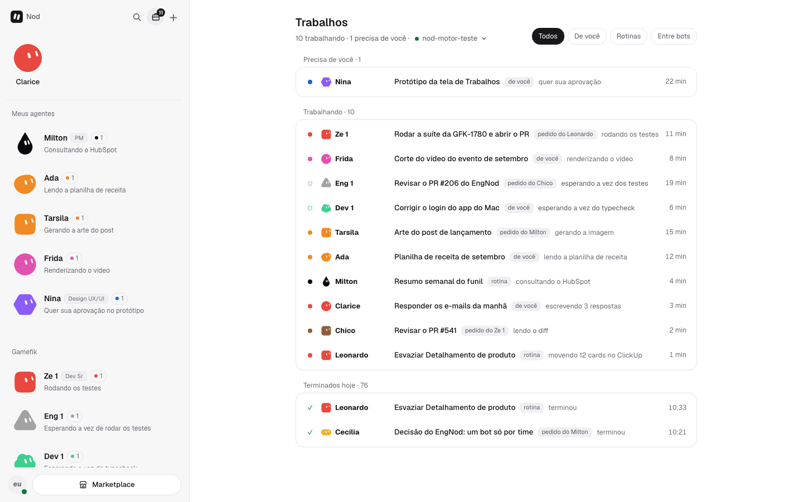
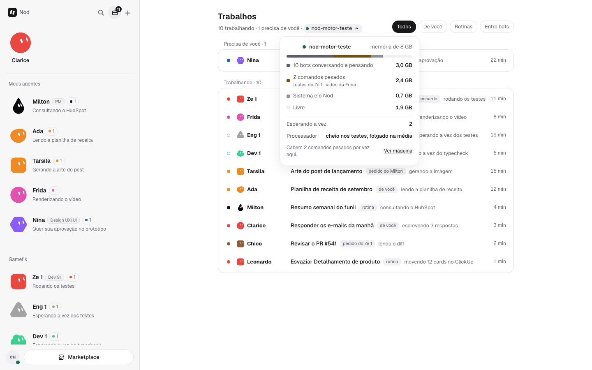
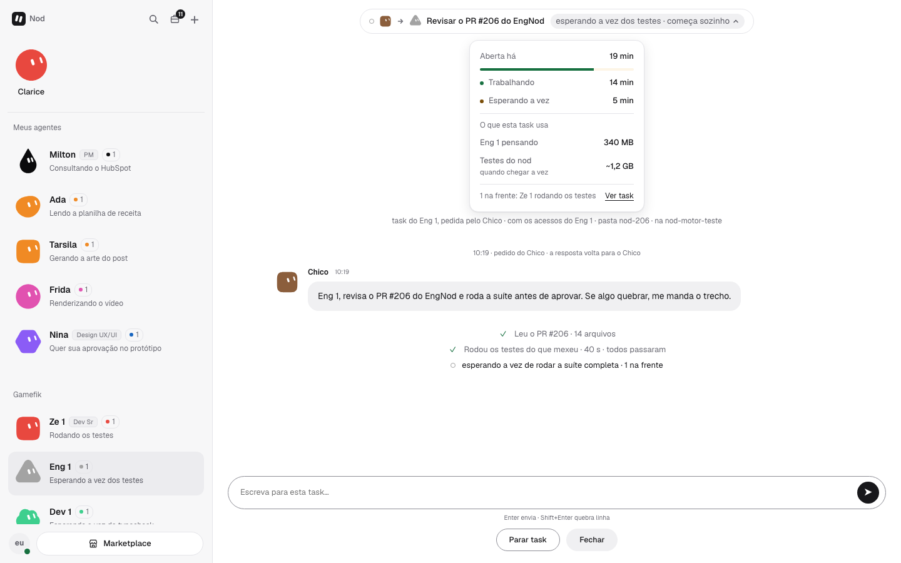
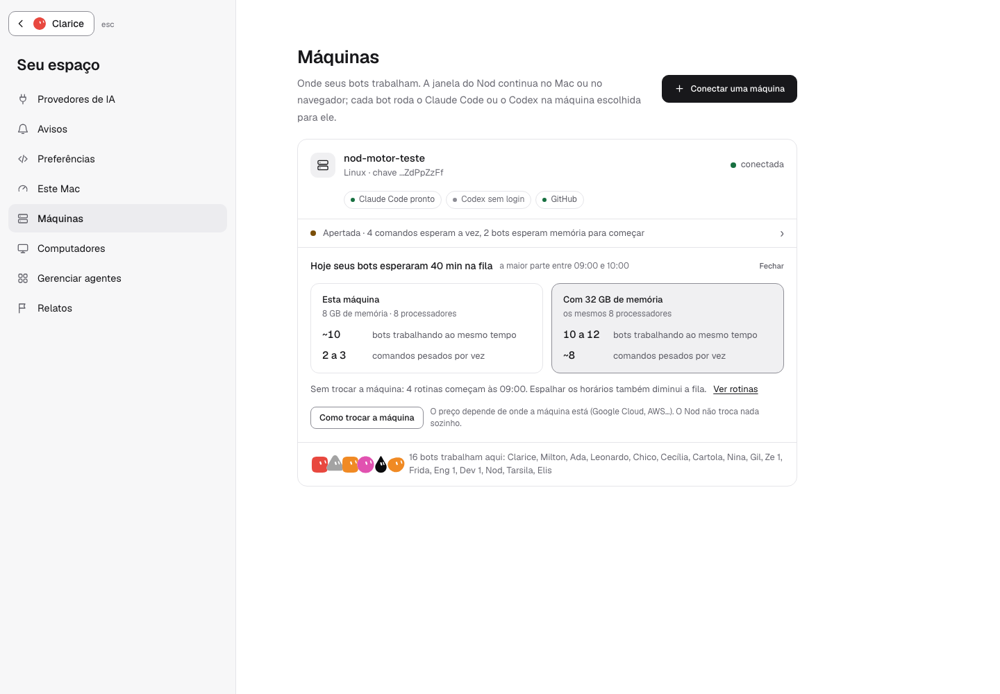

# Protótipo: agentes entram, trabalho pesado faz fila

Protótipo de alta fidelidade da [ADR-097](../../adr/adr-097-agentes-entram-trabalho-pesado-faz-fila.md) e do
[plano](../../plano-agentes-e-trabalho-pesado.md), feito em 2026-10-11 para o Marlon aprovar. O canvas interativo é
https://claude.ai/artifact/XaXtFMENn3e4T3VZowjDkG (privado, na conta em que foi criado). Esta pasta é a cópia que não
depende de acesso a ele.

- `telas/`: um PNG por estado, 1440 px de largura. Gerados a partir de `fonte/` com o CSS de `web/`, as fontes de
  `web/public/fontes/` e o `chrome-headless-shell` do Playwright.
- `fonte/`: o código das telas no formato do canvas de Design (`canvas.json` + um `.dc.html` por tela). Para reabrir
  num canvas novo, publique estes arquivos sob `project/`, mais `project/css/` com `tokens.css`, `estilos.css`,
  `interface.css` e `navegacao.css` de `web/`. Os mascotes aparecem como `/_blob/<id>`; os SVGs estão em
  `fonte/mascotes/`, gerados com o desenhista real (`web/lib/mascote-svg.ts`, pose de repouso) nas cores e formas
  dos bots de produção. Num canvas novo, suba os SVGs de novo e troque os endereços.
- Os números das telas vêm da medição de 11/10 na `nod-motor-teste` (e2-highcpu-8, 8 GB): cada agente ~300 MB e
  3–6% de um processador; typecheck ~1 GB; 2 a 3 comandos pesados por vez em 8 GB, ~8 com 32 GB. Os 40 min de
  espera e as 4 rotinas das 09:00 são exemplo.

## As telas

| Arquivo | O que mostra |
|---|---|
| `01-trabalhos.png` | Trabalhos com 10 bots trabalhando: 2 rodam comandos pesados (testes, vídeo), 2 esperam a vez (ponto vazado na cor do bot). Sem a faixa "pouca memória"; o consumo saiu das linhas |
| `02-trabalhos-consumo-da-maquina.png` | O clique no nome da máquina, no topo: memória separada em bots, comandos pesados, sistema e livre; quantos esperam a vez; processador na média |
| `03-trabalhos-maquina-apertada.png` | Máquina apertada: 4 comandos esperam a vez e 2 bots novos ficam "Na fila · começa quando liberar memória" |
| `04-task-esperando-a-vez.png` | A tela da task: status "esperando a vez dos testes · começa sozinho"; o cartão do status mostra o tempo, o que a task usa e quem está na frente; o passo "rodou os testes do que mexeu" vem antes da suíte completa |
| `05-conversa-espera-a-vez.png` | Na conversa, a linha centralizada "Ze 1 espera a vez de rodar os testes · 1 na frente" |
| `06-conversa-rodou-os-testes.png` | A mesma linha depois: "✓ Ze 1 rodou os testes · 2 min", e a resposta do bot |
| `07-maquinas.png` | Seu espaço › Máquinas: uma frase por máquina ("Folgada · 10 bots trabalhando, 2 comandos pesados por vez") |
| `08-maquinas-detalhe.png` | O detalhe atrás do chevron: memória, comandos pesados, processador na média de 5 min, disco |
| `09-maquinas-apertada.png` | Apertada, com o aviso discreto "Hoje seus bots esperaram 40 min na fila · Ver como acelerar" |
| `10-maquinas-como-acelerar.png` | O que abre: esta máquina × 32 GB de memória, a saída sem gastar (espalhar rotinas) e "Como trocar a máquina", sem preço |
| `11-descartada-medidor-de-vagas.png` | **Descartada:** medidores fixos de vagas no topo de Trabalhos. Pede atenção o tempo todo e repete o que a linha de cada task já diz |
| `12-mac-trabalhos.png` | Este Mac: Trabalhos com "6 trabalhando · Este Mac"; 1 comando pesado por vez, o Dev 1 espera a vez do typecheck |
| `13-mac-maquinas-detalhe.png` | Este Mac em Máquinas: "Folgada · 6 bots trabalhando, 1 comando pesado por vez"; atrás do chevron a memória dividida em seus apps, bots e comandos pesados, a prioridade baixa e "O quanto os bots podem usar" |
| `14-mac-apertado-como-acelerar.png` | Mac apertado pelos apps da pessoa ("Seus apps estão usando quase toda a memória · os testes esperam") e as saídas do Mac: deixar os bots usarem mais, conectar uma VM para os bots pesados, espalhar as rotinas |
| `15-varias-trabalhos-por-maquina.png` | Várias máquinas: "14 trabalhando · 2 máquinas" com o resumo por máquina aberto (vm-1 apertada, vm-2 folgada); as linhas sem nome de máquina, que aparece no hover ("na vm-2") |
| `16-varias-maquinas.png` | Máquinas com vm-1, vm-2 e o Mac, uma frase por máquina: a vm-1 apertada, a vm-2 folgada |
| `17-v3a-qualquer-maquina.png` | **V3a (recomendada), o Nod escolhe:** "Onde cada bot trabalha" com "Qualquer máquina", onde cada bot está agora, e o padrão "o Nod escolhe a mais folgada" |
| `18-v3a-task-comecou-na-vm-2.png` | V3a na task: "começou na vm-2 · a vm-1 estava cheia", e o clone da primeira vez do bot naquela máquina |
| `19-v3a-vm-2-sem-login.png` | V3a quando falta algo: "vm-2 sem login do Claude · Ze 1 não pode ir para lá", com "Entrar no Claude na vm-2" |
| `20-v3b-sugere-mover.png` | **V3b, você move:** o card da vm-1 sugere "Ze 1 e Eng 1 esperaram 40 min · a vm-2 está folgada · Mover Eng 1 para a vm-2" |

Os prós e contras de V3a e V3b estão nas notas do canvas, ao lado da última fileira. No Mac, os 16 GB e a divisão da
memória são exemplo.

