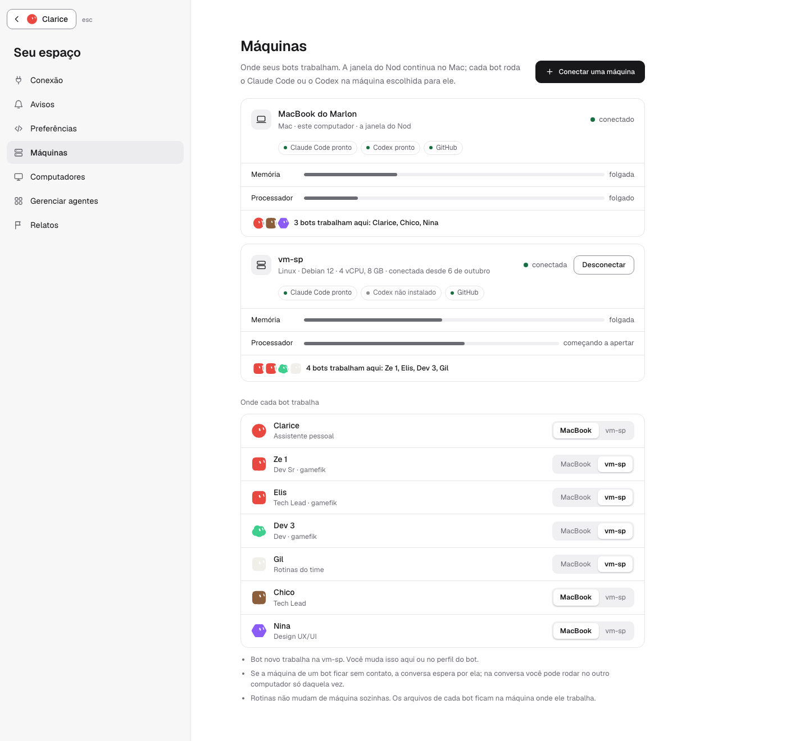
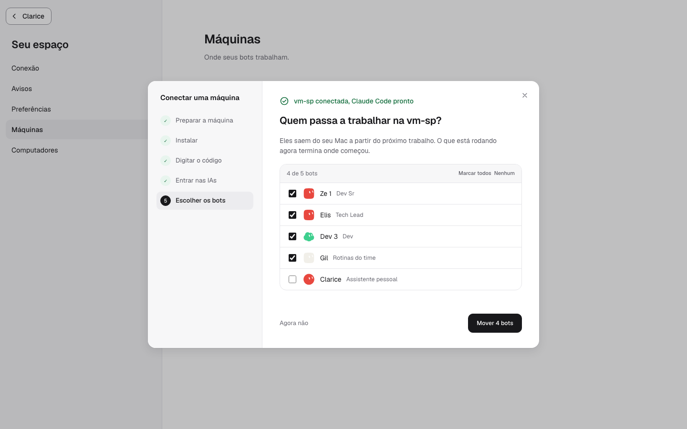
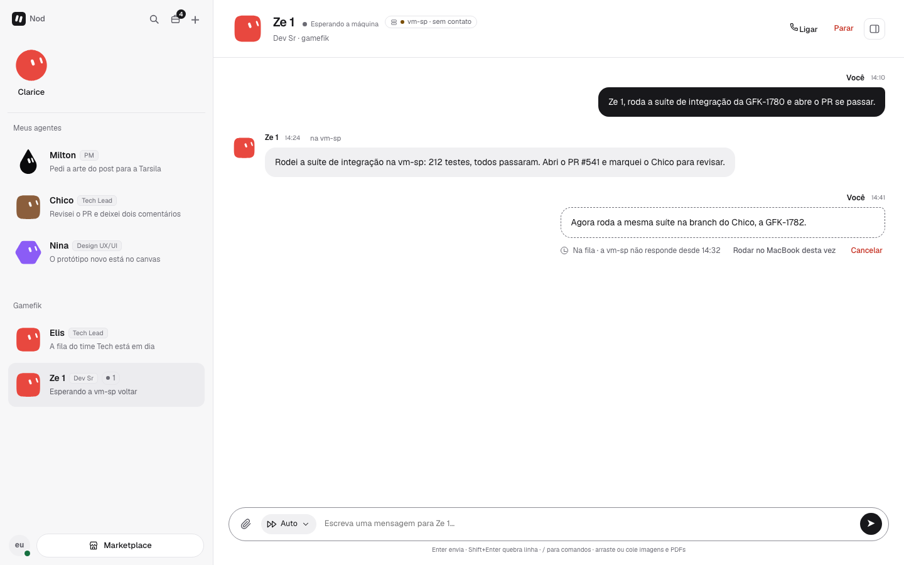

# Protótipo: motor na VM

Protótipo de alta fidelidade da [ADR-088](../../adr/adr-088-o-motor-numa-maquina-linux-da-pessoa.md) e do
[plano](../../plano-motor-na-vm.md), aprovado pelo Marlon em 2026-10-09. O canvas interativo é
https://claude.ai/artifact/JUUCPV7Y7hjnUGzw6rbr3J (privado, na conta em que foi criado). Esta pasta é a cópia que não
depende de acesso a ele.

- `telas/`: um PNG por estado, 1440 px de largura (o terminal, 960). Gerados a partir de `fonte/` com o CSS de `web/`,
  as fontes de `web/public/fontes/` e um Chrome sem janela.
- `fonte/`: o código das telas no formato do canvas de Design (`canvas.json` + um `.dc.html` por tela). Para reabrir
  num canvas novo, publique estes arquivos sob `project/`, mais `project/css/` com `tokens.css`, `estilos.css`,
  `interface.css` e `navegacao.css` de `web/`. Os mascotes aparecem como `/_blob/<id>`: num canvas novo, suba as
  imagens de novo e troque os endereços.

## As telas

| Arquivo | O que mostra |
|---|---|
| `01-maquinas.png` | Seu espaço › Máquinas: o Mac e a VM, IAs prontas, memória e processador, quem trabalha em cada uma, e onde cada bot trabalha |
| `02-maquinas-vm-fora-do-ar.png` | A mesma tela com a VM sem contato: o cartão diz quantas conversas esperam e qual rotina não rodou |
| `03` a `08` | Conectar uma máquina, em 5 passos: preparar, instalar (`curl … \| sh`), digitar o código, entrar nas IAs (aguardando e pronto) e escolher os bots, com "Marcar todos" e "Nenhum" |
| `09-terminal-da-vm.png` | O que a pessoa vê no terminal da VM: a instalação, o código e os comandos `nod-motor entrar …` |
| `10-conversa-bot-na-vm.png` | A conversa com um bot que trabalha na VM: "na vm-sp" no cabeçalho e em cada resposta |
| `11-conversa-vm-fora-aviso-na-mensagem.png` | **Escolhida (4c).** VM fora do ar: sem faixa; a mensagem na fila diz "a vm-sp não responde desde 14:32" e traz "Rodar no MacBook desta vez" e "Cancelar" |
| `12-conversa-rodou-no-mac-desta-vez.png` | Depois do clique: a linha "só desta vez" e o bot avisando que clona de novo no Mac, porque os arquivos dele estão na VM |
| `13-descartada-aviso-ambar.png` | Descartada: a faixa âmbar acima do campo (polui a tela) |
| `14-descartada-aviso-minimo.png` | Descartada: a faixa com fundo neutro e âmbar só no ícone |

