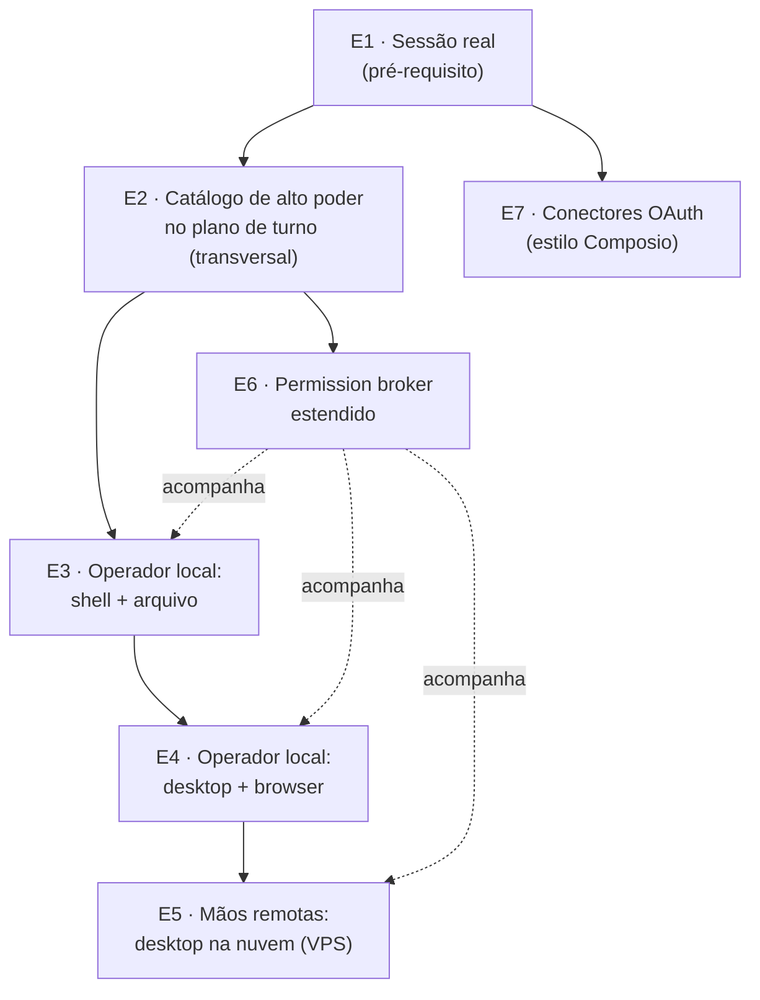

# Jornada 01 — Épicos

> Quebra da [Jornada 01](office-hours.md) em épicos. Cada épico é uma fatia de
> capacidade entregável e testável. A ordem abaixo é de dependência, não de prioridade.

## Mapa de dependências

**Escada de capacidade:** E3 (shell/arquivo) → E4 (desktop/browser) → E5 (nuvem). E1 e E2 são
fundação; E6 (aprovação) acompanha cada degrau; E7 (OAuth) é trilha paralela.

**Marco natural de meio de caminho:** com E1 + E2 + E3 + E6, o bot já opera a máquina local com
shell/arquivo sob aprovação — a metade de maior valor e menor risco topológico, sem tocar em ADR-028.

---

## E1 — Sessão real (pré-requisito)

- **Objetivo:** substituir o stub de cookie de dev por login de verdade, para que opt-ins e autoria
  sejam reais.
- **Escopo:** login Google Workspace restrito a `leapy.com.br`; emissão do **token de máquina**
  guardado no Keychain (servidor guarda só o SHA-256); liberar `NOD_HOST` fora de 127.0.0.1.
- **ADRs:** completa o que ADR-019/ADR-021 já assumiam (hoje é stub). Não é reversão.
- **Depende de:** nada.
- **Pronto quando:** uma pessoa entra pelo navegador, emite um token de máquina, e o servidor
  autentica por SHA-256 em tempo constante; o stub `marlon|ana` some.

## E2 — Catálogo de alto poder no plano de turno (transversal técnico)

- **Objetivo:** ensinar o plano de turno e o proxy a carregar **ferramentas de alto poder** sem
  quebrar o gate.
- **Escopo:** estender o `PlanoTurno` (ADR-024) para ferramentas com **tier de confiança**,
  `readOnlyHint`, **capacidade por ferramenta** e **orçamento por ação**; estender o gate do proxy
  (ADR-013) para classificar alto poder e exigir aprovação por default.
- **ADRs:** **estende** ADR-024 e ADR-013 (não reverte — o proxy continua sendo o porteiro).
- **Depende de:** E1.
- **Pronto quando:** uma ferramenta de alto poder aparece no catálogo do plano, com tier e
  `readOnlyHint`, e o proxy a nega quando não há plano válido (fail-closed preservado).

## E3 — Operador local: shell + edição de arquivo

- **Objetivo:** o bot roda comandos e edita arquivos **na máquina da pessoa**.
- **Escopo:** ferramentas de shell e de arquivo no catálogo; **opt-in por máquina**; cada ação vira
  linha na trilha com autoria composta; ações de baixo risco (`ls`, ler) correm direto, sensíveis
  pedem aprovação (via E6).
- **ADRs:** **expande** a superfície além das 9 ferramentas (toca o espírito de ADR-013/028), mas
  **não reverte ADR-028** — roda na máquina do proxy, o turno não emigra.
- **Depende de:** E2 (e E6 para os cards).
- **Pronto quando:** o bot clona um repo, roda a suíte e reporta os testes vermelhos na máquina
  local; todo `rm`/escrita passa por aprovação; tudo na trilha.

## E4 — Operador local: automação de desktop + browser

- **Objetivo:** o bot dirige mouse/teclado/tela e navega, ainda **na máquina local**.
- **Escopo:** runtime de automação de desktop (equivalente ao Cua Driver, com opt-in explícito e
  proveniência/licença resolvidas); ferramenta de browser; **sonda de disponibilidade** própria do
  runtime.
- **ADRs:** **toca ADR-019** (sonda/opt-in do runtime local). Ainda local — sem reversão de ADR-028.
- **Depende de:** E3.
- **Pronto quando:** o bot executa uma tarefa que exige clicar numa tela local e abrir um site, com
  as mesmas garantias de aprovação e trilha.

## E5 — Mãos remotas: desktop na nuvem (modelo VPS)

- **Objetivo:** o bot opera um computador **na nuvem**, com preview da tela ao vivo — sem perder o
  caminho de volta pessoa↔agente.
- **Escopo:** desktop na nuvem no **modelo VPS** (cérebro + proxy locais, só as mãos remotas, por
  transporte iniciado do lado local); preview ao vivo; "Parar" congela as mãos em < 2 s.
- **ADRs:** **refina ADR-028** via [Pré-ADR-030](../pre-adr-030-maos-remotas-modelo-vps.md). Proíbe o
  modelo `boxagent` (turno inteiro remoto).
- **Depende de:** E2, E3, E4.
- **Pronto quando:** o bot roda a tarefa num desktop na nuvem, **consegue fazer uma pergunta à
  pessoa no meio** (prova do modelo VPS), e "Parar" encerra em < 2 s.

## E6 — Permission broker estendido

- **Objetivo:** levar a aprovação tipada do nod para as ações de alto poder.
- **Escopo:** estender a **lista de aprovação item a item** para shell/arquivo/desktop; **sensível
  nasce desmarcado**; cards **Liberar/Recusar** inline; "Parar" < 2 s em todos os modos; cada
  aprovação/negação registrada com quem e quando.
- **ADRs:** **estende** a aprovação tipada já existente (spec E4.1). Não reverte.
- **Depende de:** E2 (acompanha E3–E5).
- **Pronto quando:** toda ação de alto poder pausa num card, sensível já vem desmarcado, e o desfecho
  (liberado/recusado, por quem) está na trilha.

## E7 — Conectores OAuth (estilo Composio)

- **Objetivo:** tocar apps externos (Gmail, Slack, GitHub…) por OAuth, além do MCP com env cifrado.
- **Escopo:** broker OAuth estilo Composio; primeira autorização do app; depois, o card de aprovação
  de sempre; **decisão de onde mora o token OAuth** (servidor cifrado? Keychain?).
- **ADRs:** **estende ADR-015** (segundo regime de credencial) — precisa de ADR próprio para o token.
- **Depende de:** E1.
- **Pronto quando:** o bot abre uma issue no GitHub via OAuth, com a autorização feita uma vez e as
  ações subsequentes sob aprovação.

---

## Fora de escopo (toda a jornada)

- **Companion / pareamento desktop-a-desktop via Tailscale** — decisão do dono (2026-09-16).
- **Modelo `boxagent`** (turno inteiro na máquina remota) — proibido pelo Pré-ADR-030.

## Épicos → features do OMB (rastreio)

| Épico | Ponto | Feature do OMB coberta |
|---|---|---|
| E3 | 2 | shell, edição de arquivo |
| E4 | 1 e 2 | controle da máquina local (mouse/teclado/tela), browsing |
| E5 | 1 | desktop na nuvem + preview ao vivo (no modelo VPS) |
| E6 | 2 | permission broker (cards Allow/Deny) |
| E7 | 2 | conectores estilo Composio (500+ apps, OAuth) |
| E1, E2 | — | fundação para sustentar 1 e 2 com as garantias do nod |
