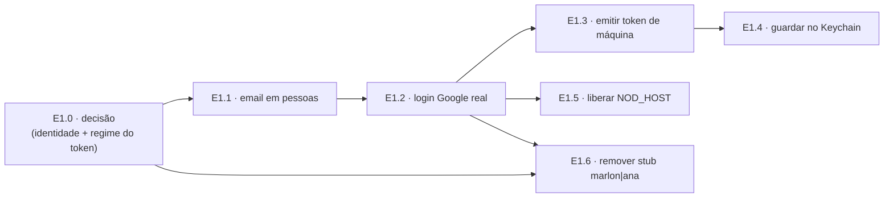

# Jornada 01 — Issues

> Quebra dos [épicos](epicos.md) da [Jornada 01](office-hours.md) em issues do tamanho de **uma
> execução de agente ponta-a-ponta** (1 PR, 1 critério de aceite = 1 teste, ≤2 ADRs por issue,
> fail-closed sempre preservado). Cada issue é um **briefing autocontido**.
>
> **Rótulo:** `US` = User Story (valor direto para uma persona); `Issue` = enabler técnico, decisão
> ou limpeza que não vira User Story honesta.
>
> **Método da quebra:** [office-hours.md](office-hours.md) (enquadramento de produto) → épicos →
> issues. Cada issue é a entrada do `/spec` na esteira Linear→código.

## Como ler cada issue

- **Contexto/porquê** — 2-3 linhas + os ADRs que estende/reverte.
- **Costuras** — os arquivos/módulos concretos a tocar (o agente não caça).
- **Escopo / Fora de escopo** — a linha vermelha explícita.
- **Aceite = o teste** — em qual dos quatro modos (unit / integration / conformidade / concurrency).
- **Depende de** — issues que precisam estar prontas antes.

---

## E1 — Sessão real

> Épico [E1](epicos.md#e1--sessão-real-pré-requisito): substituir o stub de cookie de dev por login
> de verdade, para que opt-ins e autoria sejam reais. Completa o que ADR-019/ADR-021 já assumiam.

**Ordem por dependência:** `E1.0 → E1.1 → E1.2 → { E1.3 → E1.4 } → E1.5 → E1.6`

### E1.0 — [Issue] Decidir: onde mora a identidade de quem loga, e o regime do token de máquina

Linear: LEA-7

Não é User Story — o entregável é decisão registrada (ADR), não código.

- **Contexto/porquê:** duas incógnitas travam o resto do épico. (a) `pessoas` é só-leitura para
  `nod_app` e não tem e-mail → como um login Google vira uma `pessoa`? (allowlist estática das pessoas
  semeadas por e-mail? provisionamento por `nod_dono`?). (b) O token de máquina do ADR-021 precisa
  sobreviver a restart? Hoje o token de turno é `Map` em memória (EMENDA 3). Persistir → tabela nova
  sob `nod_escopar_tabela` + RLS.
- **Costuras:** `docs/adr/`, ADR-021, ADR-015, ADR-019; `src/db/seed/index.ts`;
  `src/services/token-turno.ts`.
- **Fora de escopo:** implementar qualquer uma das duas — só decidir e escrever.
- **Aceite:** 1-2 ADRs novos (ou emendas) com gatilho de reversão, respondendo (a) e (b).
- **Depende de:** nada.

### E1.1 — [Issue] Semear e-mail `@leapy.com.br` na identidade (`pessoas.email`)

Linear: LEA-8

Enabler de dados/DB — sem valor de usuário isolado.

- **Contexto/porquê:** pré-requisito do mapeamento de E1.2. Adiciona coluna `email` em `pessoas`,
  migração como `nod_dono`, e semeia os e-mails reais das pessoas Leapy (idempotente, como o resto do
  seed).
- **Costuras:** nova migração em `src/db/`; `src/db/seed/index.ts`
  (`insert into pessoas … on conflict`); `tests/conformidade/rls.test.ts` (o gate confere que não
  quebrou policies).
- **Escopo/fora:** só a coluna + seed; **não** toca o fluxo de login (isso é E1.2).
- **Aceite:** `tests/integration` — buscar pessoa por e-mail retorna a linha certa sob escopo;
  `npm run check` (inclui conformidade) verde.
- **Depende de:** E1.0 (decisão do modelo de mapeamento).

### E1.2 — [US] Entrar no nod com minha conta Google da Leapy

Linear: LEA-9

> Como colaborador da Leapy, quero entrar no nod pelo navegador com minha conta Google Workspace
> (`@leapy.com.br`), para que minha sessão e minha autoria sejam realmente minhas — não o stub
> `marlon/ana`.

- **Contexto/porquê:** substitui `POST /api/sessao/entrar {pessoa}` pelo OAuth Google. O callback
  valida `hd=leapy.com.br` + e-mail verificado, mapeia e-mail → `pessoa` (E1.1) e cunha **o mesmo
  cookie assinado** `{tenantId, pessoaId}` que já existe (`cunharCookie`).
- **Costuras:** `src/adapters/http/sessao.ts` (novo handler OAuth + callback), `roteador.ts` (rota
  pública), reusa `cunharCookie`/`lerCookieSessao`.
- **Escopo/fora:** e-mail de outro domínio ou não-mapeado → 403 (recusa, não provisiona). **Não**
  emite token de máquina (E1.3), **não** abre `NOD_HOST` (E1.5). O stub `marlon/ana` **coexiste atrás
  de flag** até E1.6 (mantém `main` verde e fail-closed).
- **Aceite:** `tests/integration` — callback simulado com e-mail Leapy mapeado cunha cookie válido;
  e-mail de outro `hd` → 403; e-mail sem `pessoa` → 403.
- **Depende de:** E1.1.

### E1.3 — [US] Emitir um token de máquina depois de logar

Linear: LEA-10

> Como colaborador já logado no navegador, quero emitir um token de máquina, para que meu computador
> se autentique no servidor sem eu colar segredo em arquivo.

- **Contexto/porquê:** ADR-021 — a pessoa loga e "dali emite um token de máquina… do qual o servidor
  guarda só o SHA-256 com comparação em tempo constante". Espelha o padrão de `token-turno.ts`
  (`randomBytes`, `createHash('sha256')`, `timingSafeEqual`), no regime persistente decidido em E1.0.
- **Costuras:** rota `POST /api/t/:tenantId/maquinas/token` (autenticada pela sessão de E1.2); novo
  service tipo `token-maquina.ts` (emitir/validar); store conforme E1.0(b).
- **Escopo/fora:** só **emitir + validar** server-side. **Não** liga o token à autorização de
  `/api/interno` multi-máquina (ponte HTTP do ADR-021 — épico/jornada posterior). Guardar no Keychain
  é E1.4.
- **Aceite:** `tests/integration` — emitir devolve o token cru **uma única vez**; validar por SHA-256
  em tempo constante casa; token adulterado não casa; o servidor **nunca** persiste/loga o token cru
  (só o hash).
- **Depende de:** E1.2, E1.0.

### E1.4 — [US] Guardar o token de máquina no Keychain do meu computador *(condicional)*

Linear: LEA-13

> Como colaborador, quero que meu app local guarde o token de máquina no Keychain, para não ter o
> segredo em texto plano.

- **⚠️ Depende de existir superfície app-local hoje.** Pelo ADR-021 §Estado, a ponte é in-process; "a
  ponte HTTP multi-máquina entra depois". Se ainda **não** há app-local/CLI que fale HTTP, esta issue
  **é adiada para a jornada de distribuição** (ou fundida a E1.3 como "devolve o token para o operador
  guardar").
- **Costuras (se existir):** módulo app-local; `keytar`/Keychain do macOS.
- **Aceite:** o app grava o token no Keychain e o usa como `Authorization` numa chamada autenticada;
  nada em disco em texto plano.
- **Depende de:** E1.3.

### E1.5 — [Issue] Liberar `NOD_HOST` fora de 127.0.0.1 quando a sessão for real

Linear: LEA-11

Enabler de infra.

- **Contexto/porquê:** `src/adapters/http/servidor.ts` lança para host não-loopback "enquanto a sessão
  for stub por cookie". Com login real (E1.2) e o `Origin → 403` já existente (roteador), relaxar a
  trava: permite host não-loopback **quando não está em modo stub**; ainda recusa se stub.
- **Costuras:** `src/adapters/http/servidor.ts` (a guarda de `listen`), `boot.ts`.
- **Aceite:** `tests/unit` — `listen()` com `NOD_HOST=0.0.0.0` e sessão real **não** lança; em modo
  stub **ainda** lança.
- **Depende de:** E1.2.

### E1.6 — [Issue] Remover o stub `marlon|ana` (fecha o épico)

Linear: LEA-12

Limpeza / flip do "Pronto quando".

- **Contexto/porquê:** o critério de pronto do E1 é "o stub `marlon|ana` some". Remove o `PESSOAS` de
  `sessao.ts`, o handler `POST /sessao/entrar {pessoa}` e a coexistência atrás de flag.
- **Costuras:** `src/adapters/http/sessao.ts`, testes/e2e que logam pelo stub (migram para o login real
  ou um duplo de teste do OAuth).
- **Aceite:** `grep` — nenhum código de produção referencia `'marlon'|'ana'` como login;
  `e2e:fumaça` verde usando o caminho real.
- **Depende de:** E1.2 (idealmente E1.3/E1.5 já prontos).

---

**Resumo E1:** 7 issues — **3 User Stories** (E1.2, E1.3, E1.4) e **4 Issues** (E1.0 decisão, E1.1
enabler DB, E1.5 infra, E1.6 limpeza).

## E2–E7

> Ainda não quebrados. Replicam o mesmo padrão (fatia vertical, 1 PR / 1 teste, ≤2 ADRs, User Story
> por padrão) quando priorizados. Ordem por dependência dos épicos: E2 → E3 → E4 → E5; E2 → E6; E1 → E7.
