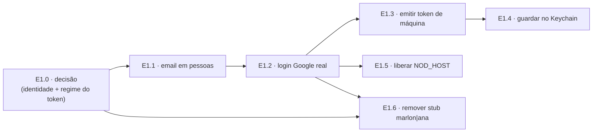
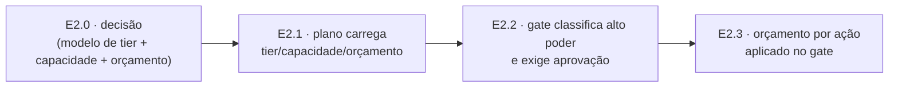
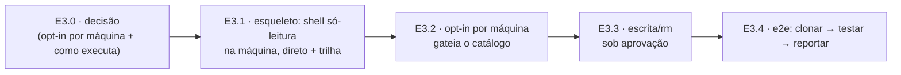
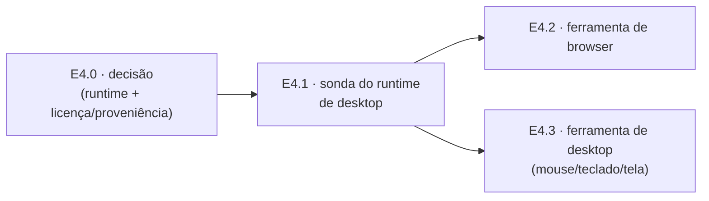
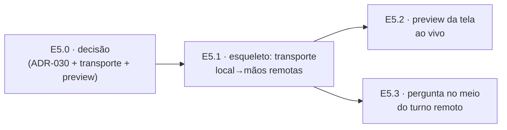
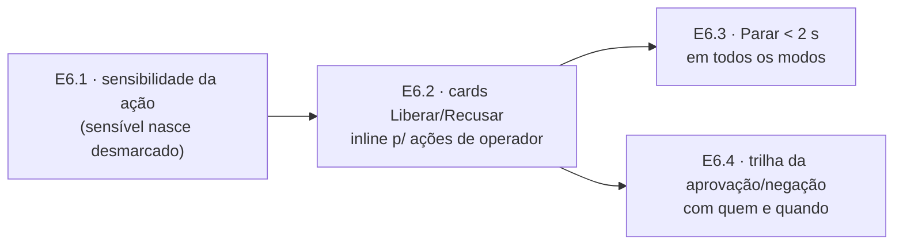
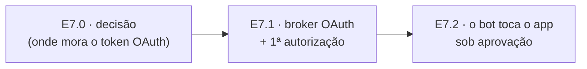

# Jornada 01 — Issues

> Quebra dos [épicos](epicos.md) da [Jornada 01](office-hours.md) em issues do tamanho de **uma
> execução de agente ponta-a-ponta** (1 PR, 1 critério de aceite = 1 teste, ≤2 ADRs por issue,
> fail-closed sempre preservado). Cada issue é um **briefing autocontido**.
>
> **Rótulo:** `US` = User Story (valor direto para uma persona); `Issue` = enabler técnico, decisão
> ou limpeza que não vira User Story honesta.
>
> **Método da quebra:** [office-hours.md](office-hours.md) (enquadramento de produto) → épicos →
> issues. Cada issue é a entrada do `/spec` na esteira Linear→código.

## Como ler cada issue

- **Contexto/porquê** — 2-3 linhas + os ADRs que estende/reverte.
- **Costuras** — os arquivos/módulos concretos a tocar (o agente não caça).
- **Escopo / Fora de escopo** — a linha vermelha explícita.
- **Aceite = o teste** — em qual dos quatro modos (unit / integration / conformidade / concurrency).
- **Depende de** — issues que precisam estar prontas antes.

---

## E1 — Sessão real

> Épico [E1](epicos.md#e1--sessão-real-pré-requisito): substituir o stub de cookie de dev por login
> de verdade, para que opt-ins e autoria sejam reais. Completa o que ADR-019/ADR-021 já assumiam.

> **Estado (2026-09-16):** E1.0, E1.1, E1.2, E1.3, E1.5 e E1.6 implementados; E1.4 adiada (não há app
> local falando HTTP). Decisões em [ADR-030](../../adr/adr-030-identidade-de-login-allowlist-por-email-semeada-nunca-provi.md)
> e [ADR-031](../../adr/adr-031-a-chave-de-maquina-persiste-carrega-o-proprio-escopo-e-e-rev.md).
> **Desvios aprovados na revisão do plano:**
> - **E1.6 não remove o stub — tranca.** O login de desenvolvimento fica, só com `NOD_LOGIN=stub`
>   explícito e só em 127.0.0.1, listando as pessoas do cadastro (sem `marlon|ana` no código). Remover
>   obrigaria cada dev a ter credencial Google e internet, sem ganho de segurança.
> - **Os testes não migraram para "o caminho real"**: nunca precisaram de login. `servidorDeTeste.entrar`
>   passou a cunhar o cookie direto, como `servidorCompleto` já fazia; o `e2e:fumaça` nunca usou o stub.
> - **E1.3 ganhou listar e revogar** (`GET`/`DELETE maquinas/chaves`): gerar chave nova não cancela a
>   velha, e sem revogação um notebook perdido seria um beco sem saída.
> - **E1.3 usa `maquina_tokens` (0007), não `maquinas`**, e a chave carrega o próprio escopo (ADR-031).
> - **E1.5 recusa segredo de sessão fraco** com `NOD_LOGIN=google` (o de exemplo do `.env.example` inclusive).
> - **A recusa do Google é um redirect para `/?entrar=recusado`**, idêntico para todos os motivos (a
>   issue dizia 403): a pessoa volta para uma tela com mensagem, não para um JSON cru.

**Ordem por dependência:** `E1.0 → E1.1 → E1.2 → { E1.3 → E1.4 } → E1.5 → E1.6`

### E1.0 — [Issue] Decidir: onde mora a identidade de quem loga, e o regime do token de máquina

Linear: LEA-7

Não é User Story — o entregável é decisão registrada (ADR), não código.

- **Contexto/porquê:** duas incógnitas travam o resto do épico. (a) `pessoas` é só-leitura para
  `nod_app` e não tem e-mail → como um login Google vira uma `pessoa`? (allowlist estática das pessoas
  semeadas por e-mail? provisionamento por `nod_dono`?). (b) O token de máquina do ADR-021 precisa
  sobreviver a restart? Hoje o token de turno é `Map` em memória (EMENDA 3). Persistir → tabela nova
  sob `nod_escopar_tabela` + RLS.
- **Costuras:** `docs/adr/`, ADR-021, ADR-015, ADR-019; `src/db/seed/index.ts`;
  `src/services/token-turno.ts`.
- **Fora de escopo:** implementar qualquer uma das duas — só decidir e escrever.
- **Aceite:** 1-2 ADRs novos (ou emendas) com gatilho de reversão, respondendo (a) e (b).
- **Depende de:** nada.

### E1.1 — [Issue] Semear e-mail na identidade (`pessoas.email`)

Linear: LEA-8

Enabler de dados/DB — sem valor de usuário isolado.

- **Contexto/porquê:** pré-requisito do mapeamento de E1.2. Adiciona coluna `email` em `pessoas`,
  migração como `nod_dono`, e semeia os e-mails reais das pessoas do time (idempotente, como o resto do
  seed).
- **Costuras:** nova migração em `src/db/`; `src/db/seed/index.ts`
  (`insert into pessoas … on conflict`); `tests/conformidade/rls.test.ts` (o gate confere que não
  quebrou policies).
- **Escopo/fora:** só a coluna + seed; **não** toca o fluxo de login (isso é E1.2).
- **Aceite:** `tests/integration` — buscar pessoa por e-mail retorna a linha certa sob escopo;
  `npm run check` (inclui conformidade) verde.
- **Depende de:** E1.0 (decisão do modelo de mapeamento).

### E1.2 — [US] Entrar no nod com minha conta Google

Linear: LEA-9

> Como pessoa do time, quero entrar no nod pelo navegador com minha conta Google Workspace
> (`@acme.com.br`), para que minha sessão e minha autoria sejam realmente minhas — não o stub
> `marlon/ana`.

- **Contexto/porquê:** substitui `POST /api/sessao/entrar {pessoa}` pelo OAuth Google. O callback
  valida `hd=acme.com.br` + e-mail verificado, mapeia e-mail → `pessoa` (E1.1) e cunha **o mesmo
  cookie assinado** `{tenantId, pessoaId}` que já existe (`cunharCookie`).
- **Costuras:** `src/adapters/http/sessao.ts` (novo handler OAuth + callback), `roteador.ts` (rota
  pública), reusa `cunharCookie`/`lerCookieSessao`.
- **Escopo/fora:** e-mail de outro domínio ou não-mapeado → 403 (recusa, não provisiona). **Não**
  emite token de máquina (E1.3), **não** abre `NOD_HOST` (E1.5). O stub `marlon/ana` **coexiste atrás
  de flag** até E1.6 (mantém `main` verde e fail-closed).
- **Aceite:** `tests/integration` — callback simulado com e-mail do domínio mapeado cunha cookie válido;
  e-mail de outro `hd` → 403; e-mail sem `pessoa` → 403.
- **Depende de:** E1.1.

### E1.3 — [US] Emitir um token de máquina depois de logar

Linear: LEA-10

> Como colaborador já logado no navegador, quero emitir um token de máquina, para que meu computador
> se autentique no servidor sem eu colar segredo em arquivo.

- **Contexto/porquê:** ADR-021 — a pessoa loga e "dali emite um token de máquina… do qual o servidor
  guarda só o SHA-256 com comparação em tempo constante". Espelha o padrão de `token-turno.ts`
  (`randomBytes`, `createHash('sha256')`, `timingSafeEqual`), no regime persistente decidido em E1.0.
- **Costuras:** rota `POST /api/t/:tenantId/maquinas/token` (autenticada pela sessão de E1.2); novo
  service tipo `token-maquina.ts` (emitir/validar); store conforme E1.0(b).
- **Escopo/fora:** só **emitir + validar** server-side. **Não** liga o token à autorização de
  `/api/interno` multi-máquina (ponte HTTP do ADR-021 — épico/jornada posterior). Guardar no Keychain
  é E1.4.
- **Aceite:** `tests/integration` — emitir devolve o token cru **uma única vez**; validar por SHA-256
  em tempo constante casa; token adulterado não casa; o servidor **nunca** persiste/loga o token cru
  (só o hash).
- **Depende de:** E1.2, E1.0.

### E1.4 — [US] Guardar o token de máquina no Keychain do meu computador *(condicional)*

Linear: LEA-13

> Como colaborador, quero que meu app local guarde o token de máquina no Keychain, para não ter o
> segredo em texto plano.

- **⚠️ Depende de existir superfície app-local hoje.** Pelo ADR-021 §Estado, a ponte é in-process; "a
  ponte HTTP multi-máquina entra depois". Se ainda **não** há app-local/CLI que fale HTTP, esta issue
  **é adiada para a jornada de distribuição** (ou fundida a E1.3 como "devolve o token para o operador
  guardar").
- **Costuras (se existir):** módulo app-local; `keytar`/Keychain do macOS.
- **Aceite:** o app grava o token no Keychain e o usa como `Authorization` numa chamada autenticada;
  nada em disco em texto plano.
- **Depende de:** E1.3.

### E1.5 — [Issue] Liberar `NOD_HOST` fora de 127.0.0.1 quando a sessão for real

Linear: LEA-11

Enabler de infra.

- **Contexto/porquê:** `src/adapters/http/servidor.ts` lança para host não-loopback "enquanto a sessão
  for stub por cookie". Com login real (E1.2) e o `Origin → 403` já existente (roteador), relaxar a
  trava: permite host não-loopback **quando não está em modo stub**; ainda recusa se stub.
- **Costuras:** `src/adapters/http/servidor.ts` (a guarda de `listen`), `boot.ts`.
- **Aceite:** `tests/unit` — `listen()` com `NOD_HOST=0.0.0.0` e sessão real **não** lança; em modo
  stub **ainda** lança.
- **Depende de:** E1.2.

### E1.6 — [Issue] Remover o stub `marlon|ana` (fecha o épico)

Linear: LEA-12

Limpeza / flip do "Pronto quando".

- **Contexto/porquê:** o critério de pronto do E1 é "o stub `marlon|ana` some". Remove o `PESSOAS` de
  `sessao.ts`, o handler `POST /sessao/entrar {pessoa}` e a coexistência atrás de flag.
- **Costuras:** `src/adapters/http/sessao.ts`, testes/e2e que logam pelo stub (migram para o login real
  ou um duplo de teste do OAuth).
- **Aceite:** `grep` — nenhum código de produção referencia `'marlon'|'ana'` como login;
  `e2e:fumaça` verde usando o caminho real.
- **Depende de:** E1.2 (idealmente E1.3/E1.5 já prontos).

---

**Resumo E1:** 7 issues — **3 User Stories** (E1.2, E1.3, E1.4) e **4 Issues** (E1.0 decisão, E1.1
enabler DB, E1.5 infra, E1.6 limpeza).

## E2 — Catálogo de alto poder no plano de turno

> Épico [E2](epicos.md#e2--catálogo-de-alto-poder-no-plano-de-turno-transversal-técnico): ensinar o
> plano de turno e o proxy a carregar **ferramentas de alto poder** sem quebrar o gate. **Estende**
> ADR-024 (formato do plano) e ADR-013 (o proxy é o porteiro) — não reverte: o proxy continua negando
> o que não tem plano válido. Fundação transversal de E3–E7.

**Ordem por dependência:** `E2.0 → E2.1 → E2.2 → E2.3`

### E2.0 — [Issue] Decidir o modelo de alto poder: tier de confiança, capacidade por ferramenta e orçamento por ação

Não é User Story — o entregável é decisão registrada (ADR), não código.

- **Contexto/porquê:** hoje o catálogo do plano só distingue `origem` (`nod`/`conector`),
  `readOnlyHint` e `tocaDadoPessoal` (`src/contracts/plano-turno.ts:11`); o `trust` é do **servidor**
  inteiro (`full`/`untrusted`, ADR-026), não da ferramenta. Falta o vocabulário para "alto poder":
  que valores tem o **tier de confiança** por ferramenta? qual o enum de **capacidade** (efeito
  externo, leitura, escrita, shell, desktop)? o **orçamento por ação** é custo, chars de argumento,
  ou tempo — e onde é medido? Decidir antes de cortar evita enfiar um `enum` improvisado no contrato.
- **Costuras:** `docs/adr/`, ADR-024, ADR-013, ADR-026; `src/contracts/plano-turno.ts`;
  `src/domain/parada-alcada.ts` (`classificarNegacao`).
- **Fora de escopo:** implementar os campos — só decidir e escrever.
- **Aceite:** 1 ADR (emenda a ADR-024) com gatilho de reversão, definindo tier, enum de capacidade e a
  unidade/ponto-de-medida do orçamento por ação.
- **Depende de:** E1 (sessão real, pré-requisito do épico).

### E2.1 — [Issue] O plano de turno carrega tier, capacidade e orçamento por ferramenta

Enabler de contrato + domínio — sem valor de usuário isolado.

- **Contexto/porquê:** materializa a decisão de E2.0 no `FerramentaPlano` e no `montarPlano`, com
  **defaults seguros** para as 9 ferramentas nod de hoje (o que já roda continua rodando). **Não**
  muda o comportamento do gate ainda (coexistência: os campos existem, ninguém os lê no proxy).
- **Costuras:** `src/contracts/plano-turno.ts` (`FerramentaPlano`); `src/domain/plano-turno.ts`
  (`montarPlano`, `FERRAMENTAS_NOD_POR_MODO`); `src/use-cases/emitir-plano-turno.ts`.
- **Escopo/fora:** só carregar os campos no plano; **não** toca `proxy.ts` (isso é E2.2).
- **Aceite:** `tests/unit` — `montarPlano` devolve cada ferramenta com `tier`/`capacidade`/`orçamento`;
  as ferramentas nod existentes recebem o default seguro; `npm run check` verde.
- **Depende de:** E2.0.

### E2.2 — [Issue] O gate do proxy classifica alto poder e exige aprovação por default

- **Contexto/porquê:** o proxy passa a **ler o tier/capacidade** da ferramenta no `tools/call`: baixo
  poder (`readOnlyHint`/tier seguro) corre direto; **alto poder cai na aprovação tipada** em vez de
  executar direto — mesmo para ferramenta de `origem: nod` (hoje só conector gera item de aprovação).
  O fail-closed do ADR-013 é **preservado**: plano ausente/expirado/catálogo vazio continua negando.
- **Costuras:** `src/adapters/mcp-proxy/proxy.ts` (o caminho do `tools/call`),
  `src/adapters/mcp-proxy/catalogo.ts` (`ferramentasMcp`), `src/domain/parada-alcada.ts`
  (`classificarNegacao`); reusa o fluxo de item de aprovação de `src/repositories/itens-aprovacao.repo.ts`.
- **Escopo/fora:** só a **rota de decisão** (alto poder → aprovação, baixo → direto). **Não** define a
  sensibilidade fina do card (E6.1) nem enforce orçamento por ação (E2.3). As ferramentas de operador
  de verdade só entram em E3 — aqui o alvo é uma ferramenta nod marcada como alto poder num duplo de teste.
- **Aceite:** `tests/integration` — no proxy, ferramenta de alto poder no plano → exige aprovação (não
  executa direto); ferramenta `readOnly`/baixo poder → executa direto; sem plano válido → nega (fail-closed).
- **Depende de:** E2.1.

### E2.3 — [Issue] Orçamento por ação aplicado no gate

- **Contexto/porquê:** hoje o corte é do **resultado** por chars (`src/adapters/mcp-proxy/corte.ts`,
  `politicaExecucao.orcamentoResultadoChars`). E2.0 define um segundo teto: **por ação** (a unidade que
  o ADR fixar). O gate passa a recusar/cortar a ação que estoura o orçamento **antes** de despachar.
- **Costuras:** `src/adapters/mcp-proxy/proxy.ts`, `src/adapters/mcp-proxy/corte.ts`;
  `src/contracts/plano-turno.ts` (`politicaExecucao`).
- **Escopo/fora:** só o orçamento **por ação**; o orçamento de resultado já existente fica como está.
- **Aceite:** `tests/unit` (domínio do orçamento) **ou** `tests/integration` (no proxy) — ação dentro
  do orçamento passa; ação que estoura é negada/cortada com negação renderizada (`estado-degradacao.ts`).
- **Depende de:** E2.2.

---

**Resumo E2:** 4 issues — todas **Issue** (transversal técnico): E2.0 decisão, E2.1 contrato, E2.2
gate, E2.3 orçamento.

## E3 — Operador local: shell + edição de arquivo

> Épico [E3](epicos.md#e3--operador-local-shell--edição-de-arquivo): o bot roda comandos e edita
> arquivos **na máquina da pessoa**. **Expande** a superfície além das 9 ferramentas (toca o espírito
> de ADR-013/028) mas **não reverte ADR-028** — roda na máquina do proxy, o turno não emigra.

**Ordem por dependência:** `E3.0 → E3.1 → E3.2 → E3.3 → E3.4`

### E3.0 — [Issue] Decidir: opt-in por máquina e onde a ferramenta de operador executa

Não é User Story — o entregável é decisão registrada (ADR).

- **Contexto/porquê:** duas incógnitas travam o épico. (a) **Opt-in por máquina**: onde mora o
  consentimento daquela máquina para ferramentas de operador? (estende o inventário/sonda do ADR-019?
  tabela nova sob `nod_escopar_tabela`?). (b) **Execução**: as ferramentas nod de hoje resolvem no
  servidor via ponte; shell/arquivo precisam rodar **na máquina do proxy** (executor local) — por qual
  superfície? (um runtime de operador local? um conector especial? o próprio executor?). ADR-028 exige
  que não emigre.
- **Costuras:** `docs/adr/`, ADR-019, ADR-028, ADR-013; `src/adapters/mcp-proxy/proxy.ts`;
  `src/contracts/inventario.ts`; `src/use-cases/decidir.ts` (`executarItens`).
- **Fora de escopo:** implementar — só decidir e escrever.
- **Aceite:** 1-2 ADRs (ou emendas) com gatilho, respondendo (a) e (b).
- **Depende de:** E2 (o catálogo de alto poder existe).

### E3.1 — [US] O bot roda um comando só-leitura na minha máquina

> Como colaborador, quero que o bot rode um comando só-leitura (`ls`, ler arquivo) na minha máquina,
> para eu ver a mão dele funcionando com a trilha registrando, sem risco.

- **Contexto/porquê:** **esqueleto ambulante** do épico — o caminho mais fino ponta-a-ponta que já liga
  a ferramenta de operador ao gate. Uma ferramenta de shell **só-leitura** (`readOnlyHint`, baixo poder
  por E2) entra no catálogo, executa na máquina do proxy e a ação vira linha na trilha com autoria
  composta (ADR-023). Corre **direto** (sem aprovação).
- **Costuras:** `src/domain/plano-turno.ts` (`FERRAMENTAS_NOD_POR_MODO`, novo nome de ferramenta);
  a superfície de execução decidida em E3.0(b); `src/repositories/trilha.repo.ts`; `src/contracts/evento.ts`
  (`Autoria`).
- **Escopo/fora:** só o caminho só-leitura, direto. **Não** escreve/apaga (E3.3); opt-in pode ficar
  **atrás de flag** aqui (o real é E3.2), mantendo `main` verde.
- **Aceite:** `tests/integration` — a ferramenta está no plano, executa um comando só-leitura, e a
  trilha registra a ação com autoria composta.
- **Depende de:** E3.0, E2.2.

### E3.2 — [Issue] Opt-in por máquina gateia o catálogo de operador

Enabler de política.

- **Contexto/porquê:** substitui a flag de E3.1 pelo consentimento real (modelo de E3.0(a)). `montarPlano`
  só inclui ferramentas de operador se aquela máquina deu opt-in; sem opt-in, o catálogo não as mostra
  (fail-closed: nada de operador aparece por default).
- **Costuras:** `src/domain/plano-turno.ts` (`montarPlano`); o store de opt-in de E3.0(a); se for tabela
  nova, migração em `src/db/migrations/` + `nod_escopar_tabela` + `tests/conformidade/rls.test.ts`.
- **Escopo/fora:** só o gate do catálogo pelo opt-in; **não** muda a UI de consentimento (fora da jornada).
- **Aceite:** `tests/unit` (ou `tests/conformidade` se criar tabela) — máquina sem opt-in → catálogo
  **sem** ferramentas de operador; com opt-in → inclui; `npm run check` verde.
- **Depende de:** E3.1.

### E3.3 — [US] Escrita e comandos destrutivos passam por aprovação

> Como colaborador, quero que toda escrita de arquivo e todo `rm`/comando sensível do bot pare num card
> **Liberar/Recusar**, para nada arriscado rodar sem meu ok.

- **Contexto/porquê:** as ferramentas de escrita/shell destrutivo entram como **alto poder** (E2.2) e
  caem na aprovação tipada, com **sensível nascendo desmarcado** (E6.1). Liberado executa e vai à
  trilha; recusado não executa e a negação vai à trilha.
- **Costuras:** `src/domain/plano-turno.ts` (novas ferramentas de escrita/shell); `src/use-cases/decidir.ts`
  (`executarItens` para a superfície de operador); `src/repositories/itens-aprovacao.repo.ts`.
- **Escopo/fora:** só escrita/rm sob aprovação. Os **cards inline** e a classificação de sensibilidade
  vêm de E6 (dependência).
- **Aceite:** `tests/integration` — proposta de escrita/`rm` pausa na aprovação; liberada → executa +
  trilha; recusada → não executa, trilha registra a negação com quem/quando.
- **Depende de:** E3.2, E6.1, E6.2.

### E3.4 — [US] O bot clona um repo, roda a suíte e me traz os testes vermelhos

> Como colaborador, quero dar "clone `acme/api`, rode os testes e me diga o que quebrou" e ver o bot
> executar ponta-a-ponta, para provar o operador local sob as garantias do nod.

- **Contexto/porquê:** é o **"Pronto quando"** do épico. Prova a cadeia inteira (só-leitura direto +
  escrita/rm sob aprovação + tudo na trilha) num fluxo real, com o executor `catcher` (custo zero).
- **Costuras:** `tests/concurrency/` (padrão `e2e-catcher.test.ts`); `tests/helpers/servidor-completo.ts`.
- **Escopo/fora:** prova do fluxo local; **não** é desktop/browser (E4) nem nuvem (E5).
- **Aceite:** `tests/concurrency` (e2e com catcher) — o bot clona, roda a suíte e reporta os vermelhos;
  todo `rm`/escrita passou por aprovação; a trilha tem a linha de cada ação.
- **Depende de:** E3.3.

---

**Resumo E3:** 5 issues — **3 User Stories** (E3.1, E3.3, E3.4) e **2 Issues** (E3.0 decisão, E3.2
opt-in).

## E4 — Operador local: desktop + browser

> Épico [E4](epicos.md#e4--operador-local-automação-de-desktop--browser): o bot dirige mouse/teclado/tela
> e navega, ainda **na máquina local**. **Toca ADR-019** (sonda/opt-in do runtime). Sem reversão de ADR-028.

**Ordem por dependência:** `E4.0 → E4.1 → { E4.2, E4.3 }`

### E4.0 — [Issue] Decidir o runtime de automação de desktop e resolver licença/proveniência

Não é User Story — o entregável é decisão registrada (ADR/pré-ADR). **Timebox.**

- **Contexto/porquê:** pergunta em aberto da [office-hours](office-hours.md#perguntas-em-aberto): "qual
  runtime de automação de desktop (equivalente ao Cua Driver) e sua licença/proveniência". Um agente de
  implementação nunca recebe issue com esta decisão embutida.
- **Costuras:** `docs/adr/`, ADR-019; `docs/roadmap/` (pré-ADR se ainda não construído).
- **Fora de escopo:** integrar o runtime — só escolher e registrar licença/proveniência.
- **Aceite:** 1 ADR (ou pré-ADR) nomeando o runtime, a licença e a proveniência resolvida, com gatilho.
- **Depende de:** E3 (o operador local existe).

### E4.1 — [Issue] Sonda de disponibilidade do runtime de desktop

Enabler de infra — estende a sonda/inventário do ADR-019.

- **Contexto/porquê:** o runtime de desktop precisa de **sonda própria** (como o CLI tem a dele): o
  inventário passa a guardar a disponibilidade do runtime por máquina, e `montarPlano` recusa as
  ferramentas de desktop quando o runtime está ausente (fail-closed, espelha `executor_indisponivel`).
- **Costuras:** `src/adapters/mcp-proxy/probe.ts` (padrão `sondarConector`); `src/contracts/inventario.ts`;
  `src/repositories/inventario.repo.ts`; `src/domain/plano-turno.ts` (recusa se runtime ausente).
- **Escopo/fora:** só a sonda + gate do catálogo; **não** implementa as ferramentas (E4.2/E4.3).
- **Aceite:** `tests/integration` — sonda publica a disponibilidade do runtime; `montarPlano` inclui as
  ferramentas de desktop só quando disponível, senão as omite.
- **Depende de:** E4.0.

### E4.2 — [US] O bot navega num site pra mim

> Como colaborador, quero que o bot abra um site e navegue, para tarefas que exigem a web, com as
> mesmas garantias de aprovação e trilha.

- **Contexto/porquê:** ferramenta de **browser** no catálogo, alto poder pelo gate (E2.2), gated pelo
  proxy. Ações de navegação sensíveis pausam no card (E6).
- **Costuras:** `src/domain/plano-turno.ts` (ferramenta de browser); superfície de execução local (E3.0b);
  `src/adapters/mcp-proxy/proxy.ts`.
- **Escopo/fora:** só o browser local. **Não** é browser em nuvem (E5).
- **Aceite:** `tests/integration` — a ferramenta de browser está no plano, executa uma navegação sob as
  garantias de aprovação/trilha.
- **Depende de:** E4.1, E6.1.

### E4.3 — [US] O bot clica numa tela da minha máquina

> Como colaborador com opt-in, quero que o bot mova mouse/teclado e clique numa tela local, para
> tarefas de desktop, sob aprovação e trilha.

- **Contexto/porquê:** ferramenta de **desktop** (mouse/teclado/tela) sobre o runtime de E4.0, com
  **opt-in explícito** (reusa E3.2) e alto poder (E2.2). Toca ADR-019 (a sonda do runtime).
- **Costuras:** `src/domain/plano-turno.ts` (ferramenta de desktop); o runtime de E4.0; opt-in de E3.2.
- **Escopo/fora:** só o desktop local; sem nuvem (E5).
- **Aceite:** `tests/integration` — a ferramenta de desktop executa um clique sob aprovação, com a ação
  na trilha e autoria composta.
- **Depende de:** E4.1, E3.2, E6.1.

---

**Resumo E4:** 4 issues — **2 User Stories** (E4.2, E4.3) e **2 Issues** (E4.0 decisão, E4.1 sonda).

## E5 — Mãos remotas: desktop na nuvem (modelo VPS)

> Épico [E5](epicos.md#e5--mãos-remotas-desktop-na-nuvem-modelo-vps): o bot opera um computador **na
> nuvem** com preview ao vivo, sem perder o caminho de volta pessoa↔agente. **Refina ADR-028** via
> [Pré-ADR-030](../pre-adr-030-maos-remotas-modelo-vps.md). Proíbe o modelo `boxagent`.

**Ordem por dependência:** `E5.0 → E5.1 → { E5.2, E5.3 }`

### E5.0 — [Issue] Promover o Pré-ADR-030 a ADR e decidir transporte e trânsito do preview

Não é User Story — o entregável é decisão registrada (ADR-030). **Timebox.**

- **Contexto/porquê:** [Pré-ADR-030](../pre-adr-030-maos-remotas-modelo-vps.md) vira o ADR definitivo
  quando a jornada for construída. Restam duas decisões da [office-hours](office-hours.md#perguntas-em-aberto):
  o **transporte iniciado do lado local** até as mãos (SSH/Docker equivalente) e **por onde o vídeo do
  preview trafega** (da máquina do provedor, não a sua).
- **Costuras:** `docs/adr/` (promove `docs/roadmap/pre-adr-030-*.md`), ADR-028; ADR-013/024 (seguem valendo).
- **Fora de escopo:** implementar o transporte — só decidir e escrever o ADR-030.
- **Aceite:** ADR-030 publicado com o transporte e o trânsito do preview definidos, e o gatilho de
  reversão herdado do pré-ADR.
- **Depende de:** E2, E3, E4 (mãos locais provadas antes das remotas).

### E5.1 — [Issue] Esqueleto: transporte iniciado localmente até as mãos remotas

Enabler + esqueleto ambulante do épico.

- **Contexto/porquê:** o processo do agente e o **proxy MCP permanecem locais**; só as mãos são remotas,
  por transporte que a **máquina local inicia** (modelo VPS). Prova mecânica: o plano (ADR-024) e o gate
  (ADR-013) continuam locais; **guarda que proíbe o `boxagent`** (turno inteiro remoto).
- **Costuras:** `src/adapters/mcp-proxy/proxy.ts` (permanece local); o transporte de E5.0; `boot.ts`/`compor.ts`.
- **Escopo/fora:** só estabelecer as mãos remotas e provar que nada emigra. **Sem** preview (E5.2) e
  **sem** pergunta-no-meio ainda (E5.3).
- **Aceite:** `tests/integration` — turno remoto: o proxy local puxa o plano local e alcança as mãos por
  transporte iniciado localmente; um teste **falha** se o turno tentar emigrar (guarda anti-`boxagent`).
- **Depende de:** E5.0.

### E5.2 — [US] Vejo a tela do desktop na nuvem ao vivo

> Como colaborador, quero ver a tela do desktop na nuvem enquanto o bot trabalha, para acompanhar em
> tempo real.

- **Contexto/porquê:** preview ao vivo trafegando da máquina **do provedor** (E5.0), sem reabrir a
  discussão de "algo alcança a SUA máquina".
- **Costuras:** o canal de preview de E5.0; a lane de eventos/SSE (`src/adapters/http/rotas/eventos.ts`)
  para sinalizar o preview à web.
- **Escopo/fora:** só o preview; o caminho de volta pessoa↔agente é provado em E5.3.
- **Aceite:** `tests/integration` — o preview transmite frames da máquina do provedor enquanto o turno
  remoto roda; o caminho de volta permanece intacto.
- **Depende de:** E5.1.

### E5.3 — [US] O bot me faz uma pergunta no meio de um turno remoto

> Como colaborador, quero que o bot consiga me perguntar/pedir aprovação no meio de um turno na nuvem,
> para que "quem decide é a pessoa" continue valendo longe da minha máquina (a linha vermelha).

- **Contexto/porquê:** **prova da linha vermelha** do Pré-ADR-030: `pedir_a_pessoa`/`pedir_aprovação`
  funcionam idênticos ao turno local. Se a implementação responder `"unavailable"` (o `boxagent.ts:294`
  do OMB), está errada **por construção**.
- **Costuras:** o fluxo de decisão existente (`src/repositories/decisoes.repo.ts`, `rotas/decisoes.ts`);
  o transporte remoto de E5.1.
- **Escopo/fora:** só o caminho de volta no turno remoto.
- **Aceite:** `tests/integration` — no meio do turno remoto, o bot emite uma pergunta e recebe a resposta
  da pessoa; um teste **falha** se a resposta for `"unavailable"` (guarda mecânica do Pré-ADR-030).
- **Depende de:** E5.1.

---

**Resumo E5:** 4 issues — **2 User Stories** (E5.2, E5.3) e **2 Issues** (E5.0 decisão, E5.1 transporte).
O "Parar < 2 s" das mãos remotas é entregue por [E6.3](#e63--issue-parar-congela-em--2-s-em-todos-os-modos).

## E6 — Permission broker estendido

> Épico [E6](epicos.md#e6--permission-broker-estendido): levar a aprovação tipada do nod às ações de
> alto poder. **Estende** a aprovação tipada já existente (não reverte). **Acompanha** E3–E5.

**Ordem por dependência:** `E6.1 → E6.2 → { E6.3, E6.4 }`

### E6.1 — [Issue] Classificar a sensibilidade de ações de shell/arquivo/desktop

Enabler de domínio — regra pura compartilhada por E3–E5.

- **Contexto/porquê:** o modelo já tem `origemSensivel` que faz o item **nascer desmarcado** com
  justificativa (`src/contracts/item-aprovacao.ts:11`). Falta a **regra** que, dado o destino da ação de
  operador (comando/argumentos), decide se é sensível (`rm`/escrita/comando destrutivo → sensível;
  `ls`/ler → não). É função pura de domínio (sem banco).
- **Costuras:** `src/domain/` (nova regra de sensibilidade); `src/contracts/item-aprovacao.ts`
  (`origemSensivel`, `justificativa`); consumida por `src/use-cases/decidir.ts`.
- **Escopo/fora:** só a classificação; o card visual é E6.2.
- **Aceite:** `tests/unit` — `rm`/escrita → `origemSensivel=true` com justificativa (nasce desmarcado);
  `ls`/ler → não sensível.
- **Depende de:** E2.2.

### E6.2 — [Issue/US] Cards Liberar/Recusar inline para ações de operador

> Como colaborador, quero ver a ação de alto poder proposta num card inline com **Liberar/Recusar**,
> para decidir sem sair do chat.

- **Contexto/porquê:** hoje a aprovação item a item cobre conector; estende a **renderização do card**
  para ações de operador de `origem: nod` (shell/arquivo/desktop). A web só faz `import type` e reidrata
  por REST a partir de frames SSE (AGENTS.md) — o card nasce do item de aprovação já existente.
- **Costuras:** `src/adapters/http/rotas/decisoes.ts`; `src/repositories/itens-aprovacao.repo.ts`;
  a web (`web/estado/reducer.ts`, render do card) por `import type`.
- **Escopo/fora:** só o card das novas ações; a classificação vem de E6.1.
- **Aceite:** `tests/integration` (rota) + `e2e:fumaca` — uma ação de alto poder proposta gera item de
  aprovação; **Liberar** executa, **Recusar** registra a negação.
- **Depende de:** E6.1.

### E6.3 — [Issue] "Parar" congela em < 2 s em todos os modos

- **Contexto/porquê:** o critério da [office-hours](office-hours.md#critérios-de-aceite) — "Parar
  encerra em < 2 s em ambos os modos". Reusa o mecanismo de parada existente
  (`src/repositories/paradas.repo.ts`), estendido para congelar as ações de operador local **e** as
  mãos remotas de E5.
- **Costuras:** `src/repositories/paradas.repo.ts`; `src/domain/parada-alcada.ts`; o transporte remoto de
  E5.1; a leitura travada de assentamento (`turnosRepo.buscarTravado`, AGENTS.md).
- **Escopo/fora:** só o "Parar" das ações de operador (local e remoto).
- **Aceite:** `tests/concurrency` — "Parar" durante uma ação de operador congela em < 2 s no modo local
  e no modo remoto (duas conexões reais).
- **Depende de:** E6.2, E5.1 (para o modo remoto).

### E6.4 — [Issue] Trilha registra cada aprovação e negação com quem e quando

- **Contexto/porquê:** o critério "cada ação, aprovação e negação vira linha na trilha inapagável, com
  autoria composta" (ADR-023/004) estendido às ações de operador — o desfecho (liberado/recusado, por
  quem, quando) fica na trilha.
- **Costuras:** `src/repositories/trilha.repo.ts`; `src/use-cases/decidir.ts` (`registrarDesfecho`);
  `src/contracts/evento.ts` (`Autoria`).
- **Escopo/fora:** só o registro do desfecho de aprovação/negação de operador.
- **Aceite:** `tests/integration` — após liberar/recusar uma ação de operador, a trilha tem a linha com
  desfecho, quem decidiu e quando (autoria composta).
- **Depende de:** E6.2.

---

**Resumo E6:** 4 issues — **1 User Story** (E6.2, valor direto do card) e **3 Issues** (E6.1 domínio,
E6.3 Parar, E6.4 trilha).

## E7 — Conectores OAuth (estilo Composio)

> Épico [E7](epicos.md#e7--conectores-oauth-estilo-composio): tocar apps externos (Gmail, Slack,
> GitHub…) por OAuth, além do MCP com env cifrado. **Estende ADR-015** (segundo regime de credencial).

**Ordem por dependência:** `E7.0 → E7.1 → E7.2`

### E7.0 — [Issue] Decidir onde mora o token OAuth do broker de conectores

Não é User Story — o entregável é decisão registrada (ADR). **Timebox.**

- **Contexto/porquê:** pergunta em aberto da [office-hours](office-hours.md#perguntas-em-aberto): o token
  OAuth mora no **servidor cifrado** (regime B do ADR-015, como o `env_cifrado` do conector via
  `src/db/cifra.ts`) ou no **Keychain** da pessoa (regime A)? O ADR-015 tem dois regimes opostos e o
  token OAuth precisa escolher um, com defesa escrita.
- **Costuras:** `docs/adr/`, ADR-015; `src/db/cifra.ts`; `src/contracts/conector.ts` (`envCifrado`).
- **Fora de escopo:** implementar o broker — só decidir e escrever.
- **Aceite:** 1 ADR estendendo ADR-015 (terceiro regime ou variação), com gatilho de reversão.
- **Depende de:** E1 (sessão real, para atrelar a autorização a uma pessoa).

### E7.1 — [Issue] Broker OAuth: primeira autorização do app

Enabler.

- **Contexto/porquê:** o fluxo OAuth (redirect + callback com `state`) que autoriza o app **uma vez** e
  guarda o token conforme E7.0. Espelha o registro de conector existente
  (`src/use-cases/registrar-conector.ts`), mas com credencial OAuth em vez de `env` cifrado manual.
- **Costuras:** `src/adapters/http/rotas/conectores.ts` (novas rotas de authorize/callback);
  `src/repositories/conectores.repo.ts`; o store de token de E7.0; reusa `lerCookieSessao` (sessão real).
- **Escopo/fora:** só autorizar e guardar o token; a **ação** do bot é E7.2. O MCP com env cifrado
  continua existindo (coexistência).
- **Aceite:** `tests/integration` — fluxo OAuth simulado guarda o token no regime de E7.0; o callback
  valida o `state`; o token cru nunca é logado/devolvido à web.
- **Depende de:** E7.0.

### E7.2 — [US] O bot abre uma issue no GitHub por OAuth, sob aprovação

> Como colaborador, quero que o bot abra uma issue no GitHub (ou mande um Slack) usando um app
> autorizado por OAuth, para tocar apps externos com a autorização feita uma vez e a ação sob o card
> de aprovação de sempre.

- **Contexto/porquê:** com o token de E7.1 presente, a ferramenta do app aparece no catálogo do plano
  como **conector `untrusted`** (ADR-026), alto poder (E2.2); a ação subsequente passa pelo card de
  aprovação (E6) e vai à trilha.
- **Costuras:** `src/domain/plano-turno.ts` (`ferramentasDeConectores`); `src/repositories/conectores.repo.ts`
  (`listarHabilitados`); `src/use-cases/decidir.ts` (`executarItens`); o token de E7.1.
- **Escopo/fora:** só executar a ação do app sob aprovação; a autorização já foi feita em E7.1.
- **Aceite:** `tests/integration` — com token OAuth presente, a ferramenta do app está no catálogo,
  executa uma ação (abrir issue) sob aprovação, e a trilha registra o desfecho.
- **Depende de:** E7.1, E6.2.

---

**Resumo E7:** 3 issues — **1 User Story** (E7.2) e **2 Issues** (E7.0 decisão, E7.1 broker).

---

## Resumo da jornada

| Épico | Issues | User Stories | Issues (enabler/decisão/limpeza) | Spike de decisão |
|---|---|---|---|---|
| E1 | 7 | 3 | 4 | E1.0 |
| E2 | 4 | 0 | 4 | E2.0 |
| E3 | 5 | 3 | 2 | E3.0 |
| E4 | 4 | 2 | 2 | E4.0 |
| E5 | 4 | 2 | 2 | E5.0 |
| E6 | 4 | 1 | 3 | — (estende o existente) |
| E7 | 3 | 1 | 2 | E7.0 |
| **Total** | **31** | **12** | **19** | **6 spikes** |

**Marco de meio de caminho** (epicos.md): **E1 + E2 + E3 + E6** — o bot opera a máquina local com
shell/arquivo sob aprovação, sem tocar ADR-028. As spikes (E2.0, E3.0, E4.0, E5.0, E7.0 + E1.0) entregam
**ADR** e correm antes das stories do seu épico — nenhum agente de implementação recebe issue com decisão
de arquitetura pendente embutida.

**Publicar no Linear:** só E1 está publicado (LEA-7…13). E2–E7 seguem
[criar-issue-no-linear.md](../criar-issue-no-linear.md) quando priorizados — labels `jornada-01` +
trilha, `blocked by` pelo "Depende de", anotando o `Linear: LEA-…` de volta aqui.
