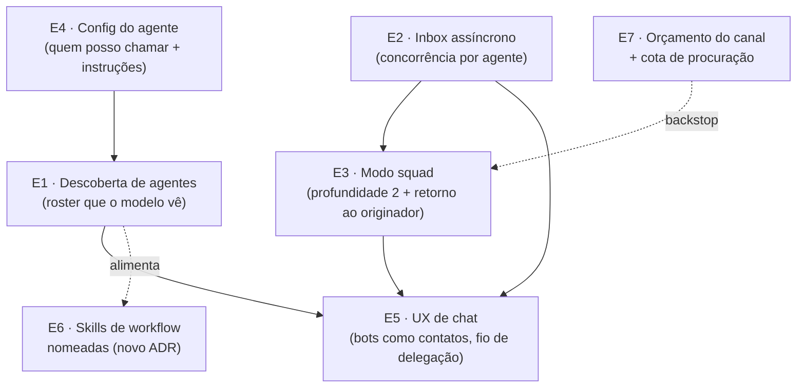

# Jornada 02 — Épicos

> Quebra da [Jornada 02](jornada-02-bots-se-chamam.md) em épicos. Lembrete do achado: **o nod já tem o
> motor bot-a-bot; falta a experiência, a configuração e as mudanças de design que decidimos.** Vários
> épicos aqui **completam** o que o nod projetou (ADR-023/025/026/027), não revertem.

## Mapa de dependências

**Marco natural (a "mágica" sem UI):** com **E4 + E1 + E2**, um bot já **encontra sozinho** o agente
certo, pergunta e retoma com a resposta — mesmo antes da UI bonita (E5). É a metade de maior valor.

---

## E1 — Descoberta de agentes (roster que o modelo enxerga)

- **Objetivo:** o bot escolher **sozinho** a quem perguntar, sem você citar ninguém — a peça que
  destrava a "mágica".
- **Escopo:** montar, no contexto do turno, um **diretório dos agentes visíveis** (nome + descrição
  curta / para que serve); expor `perguntar_a_bot` já sabendo os alvos possíveis.
- **ADRs:** **estende o plano de turno** (ADR-024) — o roster viaja no plano; cuidar do custo de
  contexto.
- **Depende de:** E4 (a descrição "para que serve" vem da config do agente).
- **Pronto quando:** um bot, sem @menção sua, resolve "quem tem essa informação?" e dispara
  `perguntar_a_bot` para o alvo certo.

## E2 — Inbox assíncrono (concorrência por agente)

- **Objetivo:** implementar a decisão "aguardar = inbox, nunca bloqueio", com coerência sob
  interrupções concorrentes.
- **Escopo:** as três disciplinas — (1) **um agente por vez** mesmo através de conversas (DM + própria
  + peer); (2) cada **"aguardando" é uma tarefa etiquetada** que a resposta retoma; (3) **prioridade
  de humano** na fila.
- **ADRs:** **estende a fila por conversa** (ADR-010) para serialização **entre** conversas do mesmo
  agente.
- **Depende de:** nada (fundação).
- **Pronto quando:** o Marola, esperando o Ressaca, atende uma pergunta sua e uma de outro bot, e
  **retoma a tarefa do 399** quando a resposta chega — sem rodar dois turnos dele em paralelo.

## E3 — Modo squad: profundidade 2 + retorno ao originador

- **Objetivo:** entre os seus agentes, permitir a cadeia A→B→C e o retorno do dead-end ao originador.
- **Escopo:** corte das ferramentas de salto passa de `profundidade >= 1` para `>= 2` (só modo squad);
  profundidade do turno **incrementa com a cadeia** (pai + 1); a **continuação do originador mantém**
  o direito de re-perguntar; **"ninguém soube" vira desfecho de primeira classe** que desenrola até o
  originador. Cross-owner permanece 0|1.
- **ADRs:** muda a regra de profundidade no domínio (`montagem-ferramentas.ts`), refina o eixo de
  profundidade (E12.4). Decisão já registrada na jornada.
- **Depende de:** E2 (a retomada/continuação é o mecanismo do retorno ao originador).
- **Pronto quando:** A→B→C dá dead-end, o "ninguém soube" volta ao A, e o A tenta outro agente sem
  aprofundar a árvore; C não consegue encadear um quarto.

## E4 — Config do agente: "quem posso chamar" + instruções

- **Objetivo:** tornar explícita e auditável a autorização e as instruções que guiam o roteamento.
- **Escopo:** seção estruturada no perfil ("faço / não faço / posso procurar X"); **default entre os
  seus agentes = todos** (sem procuração); **cross-owner via procuração** (ADR-025) com UI.
- **ADRs:** **constrói sobre** ADR-025 (procuração) e ADR-023 (autoria composta).
- **Depende de:** nada (alimenta E1).
- **Pronto quando:** cada agente tem instruções estruturadas e a lista de quem pode chamar é explícita;
  entre os seus, chamar é livre por default.

## E5 — UX de chat: bots como contatos + fio de delegação visível

- **Objetivo:** a experiência do print E-02-a — você vê `Marola → Ressaca` e `Marola → Review`.
- **Escopo:** bots como contatos na barra lateral; o **fio da delegação** visível no chat; falas de
  bot marcadas como vindas de outro bot (não suas); **@menção com autocomplete** como atalho opcional.
- **ADRs:** web sobre SSE (ADR-016) — frames já existem.
- **Depende de:** E1, E2, E3 (precisa dos eventos/threads para desenhar).
- **Pronto quando:** você pergunta a um bot e **vê o fio** dele acionando outros dois, com quem falou
  o quê.

## E6 — Skills de workflow nomeadas

- **Objetivo:** trazer de volta as skills `/` (o `acme-releases` do print), cortadas na EMENDA 24.
- **Escopo:** formato da skill; quem pode invocar; como compõem com o plano de turno (ADR-024) e a
  allowlist do agente.
- **ADRs:** **REVERTE a EMENDA 24** — precisa de **ADR próprio** (pré-esboço no roadmap primeiro).
- **Depende de:** E1 (uma skill de workflow costuma acionar outros bots).
- **Pronto quando:** um bot invoca uma skill de workflow nomeada que coordena passos e bots.

## E7 — Orçamento do canal + cota de procuração

- **Objetivo:** o backstop do modo squad — proteger por **gasto**, não por contagem.
- **Escopo:** contar o gasto por canal/rodada; ligar o **contador de cota diária** de procuração (hoje
  `gastoHoje = 0` em `perguntar-a-bot.ts`); a guarda de anel fica sempre. **O valor do teto de gasto
  está em aberto de propósito** (dono, 2026-09-16) — este épico entrega o **mecanismo**, não o número.
- **ADRs:** **constrói sobre** ADR-025 (quem paga).
- **Depende de:** nada (backstop de E3).
- **Pronto quando:** o gasto do canal é medido e um teto (quando definido) para a cadeia; a guarda de
  anel recusa loops.

---

## Fora de escopo (toda a jornada)

- **Delegação sem nenhum limite** — o modo squad relaxa a **contagem**, não a segurança: profundidade
  vai a 2, o backstop vira orçamento, e a guarda de anel permanece.
- **Bot-a-bot cruzando tenants** — um tenant só nesta rodada.

## Épicos → decisões/features (rastreio)

| Épico | Entrega | Decisão/feature |
|---|---|---|
| E1 | descoberta de agentes | a "mágica": bot roteia sem @menção |
| E2 | inbox assíncrono | decisão "aguardar = inbox, nunca bloqueio" |
| E3 | modo squad | decisão "profundidade 2 + retorno ao originador" |
| E4 | config do agente | default todos entre os seus; procuração cross-owner |
| E5 | UX de chat | experiência do print E-02-a |
| E6 | skills de workflow | reverte EMENDA 24 (novo ADR) |
| E7 | orçamento do canal | backstop por gasto (valor em aberto) |
