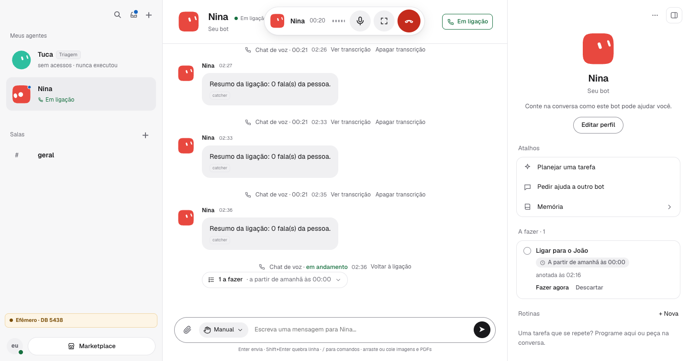
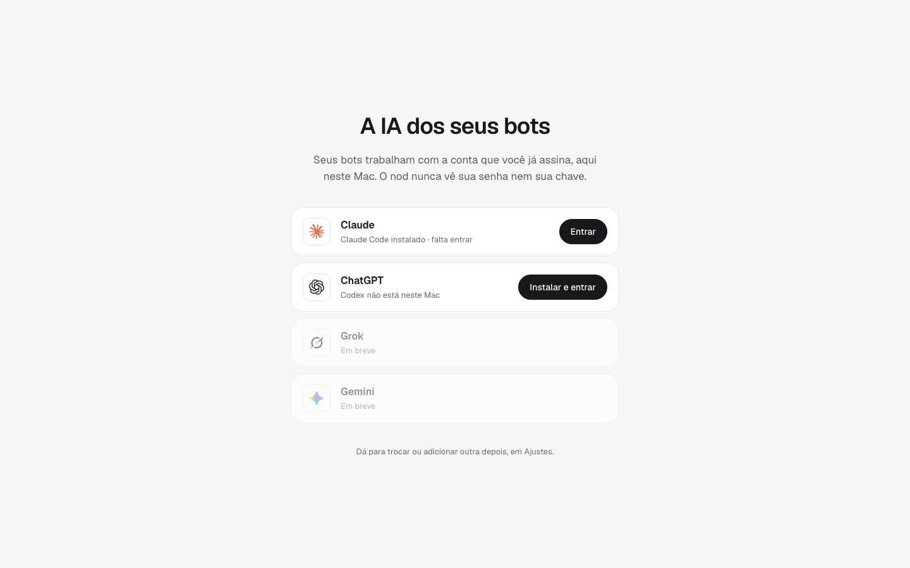
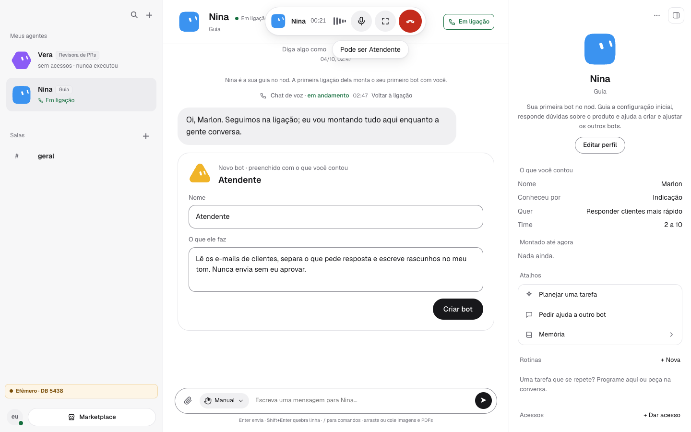
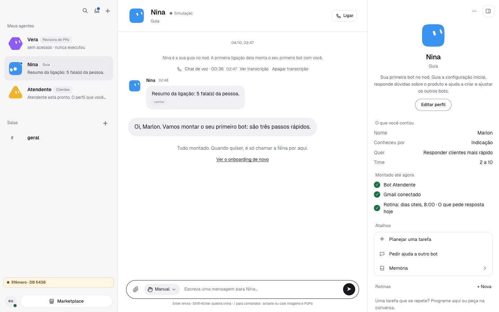

# UAT do modo ligação (2026-10-04)

Feito na madrugada de 2026-10-04 num MacBook M1 (macOS 26.0) com o branch `feat/modo-ligacao`, banco efêmero (porta
5438), servidor em `:8890` e web em `:5276`. Voz `local` (whisper.cpp `ggml-base-q5_1` + `say` do macOS); cérebro ora o
catcher (custo zero), ora o Claude Code 2.1.289 real (Haiku 4.5, assinatura; desde a NOD-164 o padrão da ligação é o Sonnet 5.5 low,
escolhido pela sonda de 2026-10-05 abaixo). Os roteiros estão no repositório e podem
ser repetidos:

- `node scripts/uat/ligacao-voz.ts --url http://127.0.0.1:8890 "frase" …` — liga, fala frases geradas com o `say` em
  tempo real (20 ms por quadro), mede as latências, salva o áudio do bot em WAV e mostra a transcrição.
- `node scripts/uat/capturar-ligacao.ts --web http://127.0.0.1:5276` — o app inteiro num Chrome headless: abre a
  conversa, aperta "Ligar", aceita o aviso, fala pelo microfone injetado, tira capturas e desliga.
- `node scripts/sonda-ligacao-claude.ts` — a sonda paga da fase 0 (Claude Code).
- `npx vitest run --project concurrency tests/concurrency/ligacao-catcher.test.ts` — o e2e de custo zero.

## Resultado

| Jornada | Como | Resultado |
|---|---|---|
| Ligar, ouvir a saudação, conversar por texto e por áudio, desligar | e2e (catcher + voz falsa) | ✅ linha "Chat de voz · mm:ss", transcrição, resumo do bot, turno concluído |
| Uma ligação viva por pessoa; Origin de outro site; sem aviso de voz | e2e | ✅ 409, 403 no upgrade, 409 |
| Aprovar por voz ("pode criar") uma rotina proposta durante a ligação | e2e | ✅ leitura do card, janela, comando, rotina criada, "Pronto, aprovado." falado |
| Comando forjado, reusado, ou com "sempre" | e2e | ✅ 403, 403, 400 |
| `iniciar_tarefa`: o bot dispara trabalho e segue a conversa; avisa falando quando termina | e2e | ✅ |
| Apagar a transcrição; avaliar a ligação | e2e | ✅ falas somem, registro e resumo ficam |
| Conversa por voz de verdade com o Claude Code | UAT voz | ✅ 3 trocas, falas de espera, bot desligou ao "pode desligar", resumo no chat |
| Bot cria pendência por voz ("me lembra de ligar para o João amanhã") | UAT voz | ✅ pendência em "A fazer" |
| Interromper o bot falando por cima ("Para, para") | UAT voz | ✅ volume cai e o servidor interrompe 0,66 s depois do começo da fala; o bot responde "Tá bom." |
| Tela cheia, pílula, presença "Em ligação", linhas "Chat de voz", "Como foi a ligação?" | UAT tela | ✅ capturas abaixo |
| Microfone e áudio pelo navegador (worklets, proxy do Vite, WebSocket) | UAT tela | ✅ 21 s de áudio recebido, 2 trocas, p50 955 ms (catcher) |

## Medições

| O quê | Valor |
|---|---|
| whisper local, do fim do trecho ao final | 182–232 ms (fala de 2,5–4 s) |
| Legenda final depois do fim real da fala | ~760–860 ms (inclui os 600 ms de silêncio do VAD) |
| Primeiro conteúdo com o Claude real, do fim da fala (VAD) | 1,6–2,1 s; ~3,6 s quando o bot usa ferramenta antes de falar |
| Espera tocada antes do conteúdo | 1,2–1,5 s depois da vez |
| Claude Code com o prompt de voz: primeiro texto | 1.628 ms a frio, 632 ms quente |
| Interrupção in-band do Claude Code | `control_response` em 5 ms, volta encerrada em 10 ms, processo vivo |
| Interrupção ponta a ponta (fala por cima → `interromper`) | 0,66 s (regra dos 600 ms de fala) |
| Custo da sonda paga | US$ 0,0035 |

## Capturas

Tela cheia, depois da primeira resposta:


Pílula sobre o app, presença "Em ligação" na barra, linhas "Chat de voz" com ver e apagar transcrição:



Depois de desligar: "Como foi a ligação?":


## Achados e o que foi corrigido na hora

- **Resumo nunca chegava** (o CLI ficava aberto): a mensagem escrita com uma volta em curso abre outra volta (medido
  pela sonda). O laço agora pula o `result` da volta que já corria e tem teto de 45 s.
- **Despedida repetida** depois de `desligar`: o que vem depois da ferramenta não é falado; se o bot desliga calado,
  toca a despedida gravada.
- **Teto da ligação não era aplicado**: agora aviso 1 min antes e encerra em `NOD_LIGACAO_MAX_S`.
- **Interrupção perdida com o whisper local** (o final chega depois da janela de 1,2 s): o final que interrompe
  ("para", duas palavras de verdade) interrompe mesmo depois da janela; o volume só volta com a pessoa calada.
- **Saudação com artigo errado** ("o Nina"): agora "Oi! Aqui é Nina." — sem inferir gênero do nome.
- **"bote" no lugar de "bot"**: vocabulário do produto passa ao STT.
- **Frases grudadas** entre blocos de texto separados por ferramenta: espaço entre os blocos.

## Limitações conhecidas

- **Chrome headless no macOS**: o `getUserMedia` fica preso esperando a permissão do sistema (TCC) mesmo com o
  dispositivo falso; o UAT de tela injeta um microfone que toca o WAV. O aparelho físico e o AEC precisam do teste
  manual no app assinado (plano, "Manual no Mac").
- **Voz do Google**: não testada ao vivo (sem credencial nesta máquina); o provedor está atrás da mesma interface e
  coberto por testes com transporte falso. O teste cego é da fase 0.
- **Codex**: só contra o app-server falso (o Codex não está instalado aqui).
- **whisper base**: erra nomes curtos ("Ouina" por "Oi Nina"); suficiente para dev (decisão de 2026-10-04: grátis e
  compreensível). Para mais acerto, `NOD_VOZ_WHISPER_MODELO` com o `small`.

## Onboarding por ligação (fase 5)

Feito com o catcher e a voz falsa (e2e `tests/concurrency/onboarding-catcher.test.ts`: etapa → Nina liga → Atender
grava o consentimento → entrevista com `anotar_entrevista` → `concluir_entrevista` → `propor_bot` aprovado por voz →
bot criado → concluir) e capturas no Chrome comparadas com o protótipo HiFiMac renderizado. Nas capturas da entrevista,
os marcadores `[[tool: …]]` aparecem na legenda porque o roteiro do catcher manda as falas por texto; numa ligação real
a pessoa só fala.

| Etapa | Captura |
|---|---|
| Olá |  |
| A IA dos seus bots (cards) |  |
| Nina está te ligando |  |
| Entrevista com "O que você contou" e "Diga algo como" |  |
| Pílula guiando: novo bot preenchido |  |
| Tudo montado |  |

Diferenças para o protótipo, por causa dos tokens do design system: o Atender usa o verde `--success` com anéis
neutros, e os links ficam sublinhados. A rotina "15 min antes de cada reunião" virou "Dias úteis, 8:00" (o cron não
expressa "antes do evento").

### Onboarding com voz real e Claude Code (`scripts/uat/onboarding-voz.ts`)

A Nina ligou ("Oi! Eu sou a Nina 2, sua primeira bot aqui no nod…" — já havia uma Nina no banco, a colisão de nome
funcionou), o roteiro atendeu e respondeu falando. O Claude extraiu os quatro campos da fala transcrita pelo whisper
local (apelido "Marlon", "indicação de um amigo", "responder e-mails dos clientes mais rápido", time "2_10"), os chips
"Diga algo como" mudaram a cada pergunta, ela leu o resumo e pediu "Certo?", e com "Isso mesmo, pode seguir" a ligação
foi para a configuração e propôs o bot "Atendente". Achado corrigido: "Marlon,." no resumo falado (o trecho cortado
na vírgula ganhava ponto).

## Sonda de modelos (NOD-164, 2026-10-05)

Pergunta: que modelo do Claude Code fala na ligação, já que a guia no "auto" passou a usar o mesmo modelo de voz das
outras ligações. Corte combinado com o Marlon: **TTFT quente ≤ 1,0 s e custo ≤ 3x o do Haiku 4.5**.

Método: `node scripts/sonda-ligacao-claude.ts --modelo <id> [--esforco low] [--pensamento adaptativo|desligado] --apps <0|2>`, com
Claude Code 2.1.289 e assinatura. A sonda usa o `montarArgsLigacao` e o `ambienteDaLigacao` reais e um MCP falso com o
kit real da ligação (16 ferramentas de `FERRAMENTAS_NOD_POR_MODO.ligacao`). `--apps 2` soma 2 apps sintéticos de 20
ferramentas (56 no total), para o catálogo pesar como num bot com conectores. Foram 3 rodadas por combinação, e 8 para
os dois finalistas. A tabela traz medianas. O custo é o `total_cost_usd` da sessão inteira da sonda em regime, ou seja,
sem a 1ª rodada de cada modelo, que paga a escrita do cache (4.6: US$ 0,047 e 0,124; 5.5 low: US$ 0,040 e 0,108;
Haiku com 2 apps: US$ 0,046).

| Apps | Modelo | n | 1º texto frio | 1º texto quente | Quentes ≤ 1 s | Custo da sessão | x Haiku |
|---|---|---|---|---|---|---|---|
| 0 (16 ferr.) | Haiku 4.5 (base) | 3 | 1,52 s | 0,54 s | 3/3 | US$ 0,0060 | 1x |
| 0 | Sonnet 4.6, adaptativo desligado | 8 | 2,23 s | 1,10 s | 1/8 | US$ 0,0160 | 2,7x |
| 0 | Sonnet 4.6, adaptativo ligado | 3 | 2,83 s | 1,03 s | 0/3 | US$ 0,0159 | 2,7x |
| 0 | **Sonnet 5.5 low** | 8 | 2,45 s | 1,05 s | 3/8 | US$ 0,0129 | 2,2x |
| 2 (56 ferr.) | Haiku 4.5 (base) | 3 | 2,38 s | 0,58 s | 3/3 | US$ 0,0117 | 1x |
| 2 | Sonnet 4.6, adaptativo desligado | 8 | 2,38 s | 1,34 s | 1/8 | US$ 0,0320 | 2,7x |
| 2 | Sonnet 4.6, adaptativo ligado | 3 | 4,04 s | 1,34 s | 0/3 | US$ 0,0320 | 2,7x |
| 2 | **Sonnet 5.5 low** | 8 | 2,67 s | 0,80 s | 5/8 | US$ 0,0272 | 2,3x |

Custo até a 2ª volta (alô + "tudo bem"), em regime, com 0 e 2 apps: Haiku US$ 0,0029 e 0,0052; Sonnet 4.6 US$ 0,0081
e 0,0145; Sonnet 5.5 low US$ 0,0050 e 0,0106. A interrupção respondeu em todos (`control_response` em ≤ 7 ms).

**Decisão: Sonnet 5.5 com esforço low e sem thinking adaptativo** (`MODELOS_LIGACAO_PADRAO`). Entre os Sonnet, é o
mais rápido no quente e o mais barato. Passa no corte com 2 apps e passa no custo nos dois casos. Sem apps, a mediana
ficou 45 ms acima de 1,0 s. O 4.6 não passa no TTFT em nenhum dos casos e custa mais. O Haiku continua no
`infra/gcp/config.env` de produção até a próxima versão do app desktop.

Ressalvas:
- Numa das 9 execuções do 5.5 low (rodada 1, sem apps), o 1º texto quente demorou 25,9 s e o frio não chegou a sair.
  Repetida isoladamente com `--bruto`, a sonda mediu 2,6 s frio e 0,98 s quente. Ficou como ponto fora da curva, mas
  vale vigiar no `primeiro_delta_ms` do log `ligacao_vez` depois do deploy.
- Com prompts curtos, ligar ou desligar o thinking adaptativo não mudou o 4.6 de forma mensurável.
- Um app desktop sem `--effort` roda o 5.5 com o esforço padrão (sai o log `ligacao_sem_effort`). É mais um motivo para
  trocar a config só junto com a versão nova do app.
- Os apps são sintéticos, e a sonda não fala nem ouve. A ligação real com microfone (UAT do Marlon) confirma a 1ª fala.

## Voz do Google ao vivo e teste cego em pt-BR (NOD-166, 2026-10-05)

**Estado: roteiro pronto, medições pendentes.** As medições precisam do ADC do projeto de produção (`gcloud auth
application-default login` com a conta do projeto) e, no STT, do whisper `base` baixado (`scripts/voz/preparar-local.sh`).
O PR da NOD-166 entregou os scripts e o limitador da cota; os números entram nas tabelas abaixo quando rodarem.

Preparação, uma vez:

```sh
gcloud auth application-default login
export NOD_VOZ_PROJETO=<projeto de produção> NOD_VOZ_GCLOUD_BIN=$(which gcloud)
bash scripts/voz/preparar-local.sh   # whisper base, para a linha de base do STT
```

O corpus de voz fica **fora do repositório** (vozes com consentimento): uma pasta com os WAVs e um `esperado.json`, uma
lista de `{ "arquivo", "texto", "nomes"?: ["Nina"], "comando"?: { "perfil": "estrito"|"proposta", "acao":
"aprovar"|"recusar"|…, "nomeBot"? } }` (formato em `scripts/voz/medidas-teste-cego.ts`). Inclua recusas parecidas com
aprovação ("não aprovo", "não, pode não"): são elas que medem o pior erro.

| # | O quê | Comando | Passa se |
|---|---|---|---|
| 1 | STT: Google contra whisper `base`, mesmo corpus em tempo real | `node scripts/teste-cego-voz.ts stt --corpus ~/corpus-voz` | Google com nomes de bots ≥ 90%, comandos ≥ 95% e zero recusa → aprovação |
| 2 | O vocabulário pela `systemInstruction` ajuda? | `node scripts/teste-cego-voz.ts stt --corpus ~/corpus-voz --so google --sem-vocabulario` | comparar a taxa de nomes com a do item 1 |
| 3 | TTS: 25 frases × 8 vozes, cego, ≥ 5 ouvintes | `node scripts/teste-cego-voz.ts tts --saida ~/teste-cego-tts` e, com as notas de volta, `node scripts/teste-cego-voz.ts apurar --gabarito ~/teste-cego-tts/gabarito.json --notas a.csv b.csv …` | voz com MOS < 3,5 sai do catálogo da Release 1 |
| 4 | Rotação da sessão do STT aos 9 min | `NOD_CORPUS_VOZ=~/corpus-voz node scripts/voz/sonda-google.ts --duracao 12m` | um `voz_stt_rotacao`, nenhum `voz_stt_rotacao_falhou`, um final por trecho; sai com código 0 |
| 5 | Limite real da sessão e formato do `goAway` | `node scripts/voz/sonda-google.ts --duracao 11m --sem-rotacao` | anotar a idade e o código do fechamento e o `goAway` (do diagnóstico em `$TMPDIR/sonda-google-diagnostico.json`) |
| 6 | O fluxo de streaming conta na cota de 200/min? (fora do horário de uso) | `node scripts/voz/sonda-google.ts --cota 220` | algum `grpc_8`/`http_429`: conta (o limitador já conta assim); todos `ok`: não conta |
| 7 | Pico de TTS com 3 ligações ao mesmo tempo | servidor com voz `google`, catcher e 3 pessoas no login stub (o seed tem 2: crie a terceira com um insert em `pessoas` no banco efêmero); `node scripts/uat/ligacao-voz.ts --url http://127.0.0.1:8890 --paralelas 3 "frase" …` | o `tts_pico_min` (pico do processo, somando as 3) fica abaixo de 180 e nenhum `voz_tts_limitado` com `descartado:false` |
| 8 | "A CONFIRMAR" do transcritor (`modelTurn`, `inputTranscription` em pedaços ou acumulado, `finished`) | `node scripts/voz/sonda-google.ts clara` | o resumo no fim da sonda; atualizar o comentário de `src/adapters/voz/google-transcricao.ts` |

Custo estimado: centavos de STT e de TTS nos itens 1, 2, 4, 5 e 8; o item 3 sintetiza ~200 frases (~12 mil caracteres, ~US$ 0,40 no Chirp 3
HD); o item 6 são 220 frases curtas.

### Resultados

| Medição | Valor |
|---|---|
| STT Google: nomes / comandos / recusa → aprovação | a medir |
| STT whisper `base`: nomes / comandos / recusa → aprovação | a medir |
| Vocabulário na `systemInstruction` (nomes com / sem) | a medir |
| MOS por voz (8 vozes) e quais saem | a medir |
| Rotação aos 9 min | a medir |
| Limite da sessão sem rotação e `goAway` | a medir |
| Fluxo de streaming conta na cota | a medir |
| `tts_pico_min` com 3 ligações | a medir |
