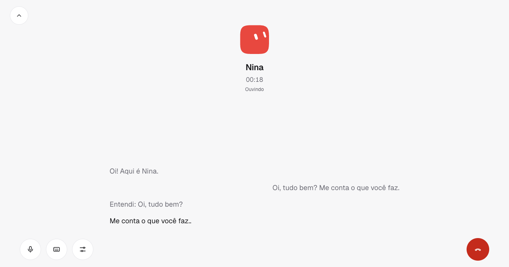
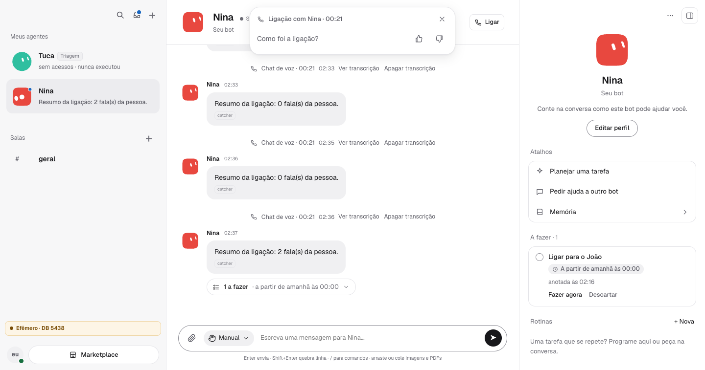
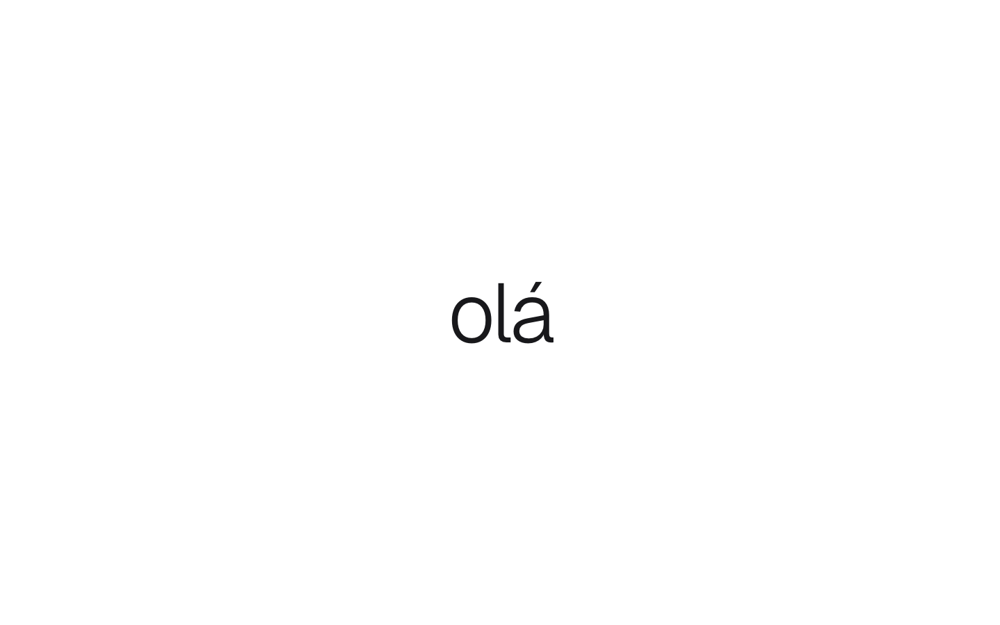
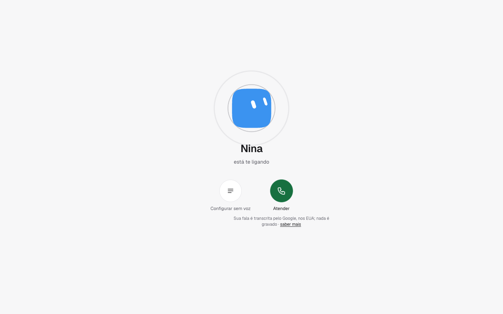
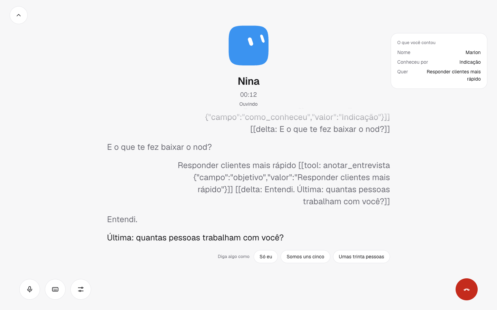

# UAT do modo ligação (2026-10-04)

Feito na madrugada de 2026-10-04 num MacBook M1 (macOS 26.0) com o branch `feat/modo-ligacao`, banco efêmero (porta
5438), servidor em `:8890` e web em `:5276`. Voz `local` (whisper.cpp `ggml-base-q5_1` + `say` do macOS); cérebro ora o
catcher (custo zero), ora o Claude Code 2.1.289 real (Haiku 4.5, assinatura). Os roteiros estão no repositório e podem
ser repetidos:

- `node scripts/uat/ligacao-voz.ts --url http://127.0.0.1:8890 "frase" …` — liga, fala frases geradas com o `say` em
  tempo real (20 ms por quadro), mede as latências, salva o áudio do bot em WAV e mostra a transcrição.
- `node scripts/uat/capturar-ligacao.ts --web http://127.0.0.1:5276` — o app inteiro num Chrome headless: abre a
  conversa, aperta "Ligar", aceita o aviso, fala pelo microfone injetado, tira capturas e desliga.
- `node scripts/sonda-ligacao-claude.ts` — a sonda paga da fase 0 (Claude Code).
- `npx vitest run --project concurrency tests/concurrency/ligacao-catcher.test.ts` — o e2e de custo zero.

## Resultado

| Jornada | Como | Resultado |
|---|---|---|
| Ligar, ouvir a saudação, conversar por texto e por áudio, desligar | e2e (catcher + voz falsa) | ✅ linha "Chat de voz · mm:ss", transcrição, resumo do bot, turno concluído |
| Uma ligação viva por pessoa; Origin de outro site; sem aviso de voz | e2e | ✅ 409, 403 no upgrade, 409 |
| Aprovar por voz ("pode criar") uma rotina proposta durante a ligação | e2e | ✅ leitura do card, janela, comando, rotina criada, "Pronto, aprovado." falado |
| Comando forjado, reusado, ou com "sempre" | e2e | ✅ 403, 403, 400 |
| `iniciar_tarefa`: o bot dispara trabalho e segue a conversa; avisa falando quando termina | e2e | ✅ |
| Apagar a transcrição; avaliar a ligação | e2e | ✅ falas somem, registro e resumo ficam |
| Conversa por voz de verdade com o Claude Code | UAT voz | ✅ 3 trocas, falas de espera, bot desligou ao "pode desligar", resumo no chat |
| Bot cria pendência por voz ("me lembra de ligar para o João amanhã") | UAT voz | ✅ pendência em "A fazer" |
| Interromper o bot falando por cima ("Para, para") | UAT voz | ✅ volume cai e o servidor interrompe 0,66 s depois do começo da fala; o bot responde "Tá bom." |
| Tela cheia, pílula, presença "Em ligação", linhas "Chat de voz", "Como foi a ligação?" | UAT tela | ✅ capturas abaixo |
| Microfone e áudio pelo navegador (worklets, proxy do Vite, WebSocket) | UAT tela | ✅ 21 s de áudio recebido, 2 trocas, p50 955 ms (catcher) |

## Medições

| O quê | Valor |
|---|---|
| whisper local, do fim do trecho ao final | 182–232 ms (fala de 2,5–4 s) |
| Legenda final depois do fim real da fala | ~760–860 ms (inclui os 600 ms de silêncio do VAD) |
| Primeiro conteúdo com o Claude real, do fim da fala (VAD) | 1,6–2,1 s; ~3,6 s quando o bot usa ferramenta antes de falar |
| Espera tocada antes do conteúdo | 1,2–1,5 s depois da vez |
| Claude Code com o prompt de voz: primeiro texto | 1.628 ms a frio, 632 ms quente |
| Interrupção in-band do Claude Code | `control_response` em 5 ms, volta encerrada em 10 ms, processo vivo |
| Interrupção ponta a ponta (fala por cima → `interromper`) | 0,66 s (regra dos 600 ms de fala) |
| Custo da sonda paga | US$ 0,0035 |

## Capturas

Tela cheia, depois da primeira resposta:

Pílula sobre o app, presença "Em ligação" na barra, linhas "Chat de voz" com ver e apagar transcrição:

Depois de desligar: "Como foi a ligação?":

## Achados e o que foi corrigido na hora

- **Resumo nunca chegava** (o CLI ficava aberto): a mensagem escrita com uma volta em curso abre outra volta (medido
  pela sonda). O laço agora pula o `result` da volta que já corria e tem teto de 45 s.
- **Despedida repetida** depois de `desligar`: o que vem depois da ferramenta não é falado; se o bot desliga calado,
  toca a despedida gravada.
- **Teto da ligação não era aplicado**: agora aviso 1 min antes e encerra em `NOD_LIGACAO_MAX_S`.
- **Interrupção perdida com o whisper local** (o final chega depois da janela de 1,2 s): o final que interrompe
  ("para", duas palavras de verdade) interrompe mesmo depois da janela; o volume só volta com a pessoa calada.
- **Saudação com artigo errado** ("o Nina"): agora "Oi! Aqui é Nina." — sem inferir gênero do nome.
- **"bote" no lugar de "bot"**: vocabulário do produto passa ao STT.
- **Frases grudadas** entre blocos de texto separados por ferramenta: espaço entre os blocos.

## Limitações conhecidas

- **Chrome headless no macOS**: o `getUserMedia` fica preso esperando a permissão do sistema (TCC) mesmo com o
  dispositivo falso; o UAT de tela injeta um microfone que toca o WAV. O aparelho físico e o AEC precisam do teste
  manual no app assinado (plano, "Manual no Mac").
- **Voz do Google**: não testada ao vivo (sem credencial nesta máquina); o provedor está atrás da mesma interface e
  coberto por testes com transporte falso. O teste cego é da fase 0.
- **Codex**: só contra o app-server falso (o Codex não está instalado aqui).
- **whisper base**: erra nomes curtos ("Ouina" por "Oi Nina"); suficiente para dev (decisão de 2026-10-04: grátis e
  compreensível). Para mais acerto, `NOD_VOZ_WHISPER_MODELO` com o `small`.

## Onboarding por ligação (fase 5)

Feito com o catcher e a voz falsa (e2e `tests/concurrency/onboarding-catcher.test.ts`: etapa → Nina liga → Atender
grava o consentimento → entrevista com `anotar_entrevista` → `concluir_entrevista` → `propor_bot` aprovado por voz →
bot criado → concluir) e capturas no Chrome comparadas com o protótipo HiFiMac renderizado. Nas capturas da entrevista,
os marcadores `[[tool: …]]` aparecem na legenda porque o roteiro do catcher manda as falas por texto; numa ligação real
a pessoa só fala.

| Etapa | Captura |
|---|---|
| Olá |  |
| A IA dos seus bots (cards) |  |
| Nina está te ligando |  |
| Entrevista com "O que você contou" e "Diga algo como" |  |
| Pílula guiando: novo bot preenchido |  |
| Tudo montado |  |

Diferenças para o protótipo, por causa dos tokens do design system: o Atender usa o verde `--success` com anéis
neutros, e os links ficam sublinhados. A rotina "15 min antes de cada reunião" virou "Dias úteis, 8:00" (o cron não
expressa "antes do evento").
